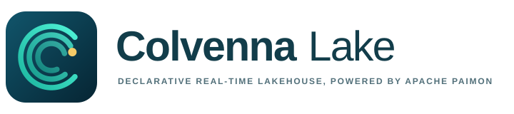
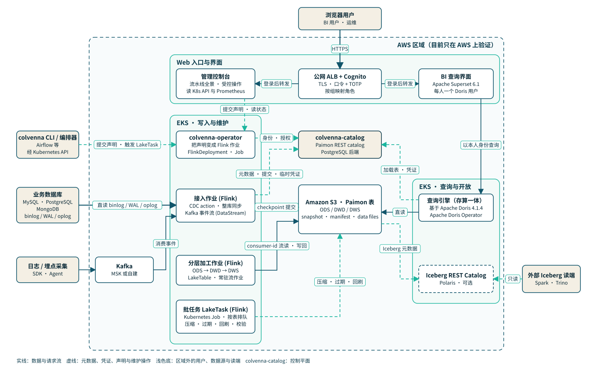

<!-- markdownlint-disable-file MD041 -->

<p align="center">
  <picture>
    <source media="(prefers-color-scheme: dark)" srcset="assets/brand/logo-dark.svg">
    
  </picture>
</p>

<p align="center"><strong>Declarative real-time lakehouse, powered by <a href="https://paimon.apache.org/">Apache Paimon</a></strong></p>

<p align="center">Database CDC and event streams land in the lake within minutes, and one copy of the data serves both streaming pipelines and interactive analytics.</p>

<p align="center">
  <a href="#quick-start">Quick start</a> ·
  <a href="docs/manual/install.md">Install manual</a> ·
  <a href="docs/manual/user.md">User manual</a> ·
  <a href="docs/design/hld-realtime-lakehouse.md">Design</a> ·
  <a href="#project-status">Status</a> ·
  <a href="docs/history/README.md">Development history</a>
</p>

<p align="center">
  <a href="LICENSE"></a>
  <a href="#project-status"></a>
  
  
  <a href="#documentation"></a>
</p>

<p align="center">
  <a href="assets/video/colvenna-lake-promo.mp4"></a>
</p>

<p align="center">An 81-second overview with captions. The GIF is silent; the <a href="assets/video/colvenna-lake-promo.mp4">MP4</a> has the narration. Its figures are the development baseline in <a href="#performance-baseline">Performance baseline</a>, not a measurement of a release candidate.</p>

---

## Why Colvenna Lake

More and more teams want one system for both the real-time pipeline and the analytical warehouse. Every update in a business database and every event from an application should show up, within minutes, in the same queryable data, instead of going into [Apache Kafka](https://kafka.apache.org/), then into a warehouse, and then into yet another copy in a lake. Open table formats make this possible, but building it is expensive: a team has to assemble the table format, stream processing, a message queue, a metadata service, query engines and maintenance jobs, and then find the problems one by one in production.

Colvenna Lake packages that assembly as a product, powered by [Apache Paimon](https://paimon.apache.org/), [Apache Flink](https://flink.apache.org/) and [Apache Doris](https://doris.apache.org/). You declare sources, layered tables, dashboards and tasks as Kubernetes resources. colvenna-operator, the Colvenna Lake operator, turns them into Paimon tables on S3, Flink jobs, Doris dashboards and maintenance runs. Its catalog server, colvenna-catalog, keeps commits atomic and gives each job credentials for its own tables only.

The product was called Cove Lake until 2026-10-24; its technical identifiers followed on 2026-10-25 and are all `colvenna` now ([naming record](release/trademarks.md#7-产品名从-cove-lake-到-colvenna-lake)).

## Features

Everything in this list has passed acceptance on AWS (EKS and S3) with synthetic data. The limits that apply are listed in [Project status](#project-status) and in the [user manual](docs/manual/user.md). Component versions are in [Technology stack](#technology-stack).

- **Declarative ingestion.** A `LakeSource` describes one CDC source (MySQL, PostgreSQL or MongoDB) or one Kafka event stream; a MySQL source can also read Debezium JSON from your own Kafka. colvenna-operator creates the Paimon tables, generates and runs the Flink jobs, and adds columns when the source adds them. CDC lands in primary-key tables and events in append tables partitioned by event time, each with defaults that have been verified. New tables land in an ingest database that only their source can read. A table is published to readers only once its classification and retention are declared, and its subject keys too if it holds personal data.
- **Layered tables as SQL.** ODS, DWD and DWS are all Paimon tables. A `LakeTable` declares one Flink SQL query and its upstream tables. colvenna-operator checks the query in a Kubernetes Job and runs it as a `FlinkDeployment` managed by the Apache Flink Kubernetes Operator. When the query changes, it upgrades the job through a savepoint and rolls back if the upgrade fails.
- **Managed maintenance and backfill.** CDC writers that read the binlog or WAL directly, and event-stream writers, only write. Compaction, snapshot expiry, orphan-file removal, tags, backfills and quality checks run as one-off `LakeTask` resources, each a Kubernetes Job, queued per table. You start them from the `colvenna` CLI, the management console, or your own scheduler through the Kubernetes API; [Apache Airflow](https://airflow.apache.org/) 2.10 has passed acceptance. Tables whose changelog is produced by lookup (`changelog-producer = lookup`: layered tables, MongoDB and Kafka-carried CDC) are compacted by their own writers.
- **Quality gates.** `LakeQuality` declares batch rules and publishing gates; `LakeWaiver` records an approved exception to a failed rule.
- **A built-in control plane.** colvenna-catalog is a Paimon REST catalog server backed by PostgreSQL. It is [Colvenna Catalog](https://github.com/colvenna/colvenna-catalog), a product of its own: every environment installs the release Colvenna Lake pins, v1.0.0-rc.1, by digest ([`deploy/images/colvenna-catalog.json`](deploy/images/colvenna-catalog.json)). It does the following:
  - commits snapshots atomically on the server;
  - authenticates services with bearer tokens, which are opaque, stored only as hashes, and can expire or be revoked;
  - grants each service identity specific tables;
  - issues short-lived S3 credentials scoped to one table's prefix;
  - audits writes, credential issuance, and authentication and authorization denials.

  colvenna-operator gives every source, table, dashboard, erasure request and running task its own catalog identity, with only the grants it needs.
- **One copy, many readers.** The platform's query engine, a build based on Apache Doris 4.1.4 with a Paimon 2.0.0 reader built for it, queries the Paimon tables in place. A `LakeDashboard` picks a read path for each dashboard query: external views for detail and lookups, asynchronous materialized views for fixed aggregates, and internal tables for small hot dimensions. Each dashboard gets its own Doris user and workload group. Tables can also be published with [Apache Iceberg](https://iceberg.apache.org/) metadata to an Iceberg REST catalog ([Apache Polaris](https://polaris.apache.org/) in acceptance), so that [Apache Spark](https://spark.apache.org/) and Trino read the same files. Lineage goes to Marquez through OpenLineage.
- **Governance and erasure.**
  - Every table declares an owner, a level from L1 to L4, personal-data categories, retention and subject keys.
  - An unclassified table is treated as L4 and is not published.
  - A downstream table cannot have a lower level than its upstream.
  - A table with personal data, or an unclassified one, keeps at most 24 hours of history. For such tables from sources that only write (MySQL and PostgreSQL read directly), colvenna-operator creates a snapshot-expiry task every hour.
  - Column tags, masking views and Doris row policies apply on the platform Doris dashboard path.
  - `LakeErasure` (or `colvenna forget`) erases one data subject across the copies the platform manages, and reports a copy as erased only after checking it.
- **An authenticated web entry point.** A public Application Load Balancer sends every request through an Amazon Cognito login (password and TOTP) before it reaches the two web interfaces. One is the BI interface, built on [Apache Superset](https://superset.apache.org/), where each person queries as their own Doris user. The other is the management console. It shows the status, metrics, alerts and flow of every stage from source to dashboard, and offers the same guarded operations as the CLI, with confirmation and audit.
- **One-command install.** `deploy/install.sh` deploys the AWS stacks (TypeScript CDK), builds the images, installs every component and runs the checks. `deploy/uninstall.sh` removes an environment and verifies that nothing is left.

## Architecture

<p align="center"></p>

Solid lines are data and requests; dashed lines are metadata, credentials, declarations and maintenance. The Mermaid source and the Go generator are in [`assets/architecture/`](assets/architecture/), and an interactive version is in [`docs/design/diagrams/colvenna-lake-architecture.html`](docs/design/diagrams/colvenna-lake-architecture.html).

- **Sources and messaging.** Apache Flink CDC reads the database binlog, WAL or oplog directly. Logs and app events come in through Kafka, which you provide (Amazon MSK, Confluent or self-managed); the platform does not create a production Kafka.
- **EKS write and maintenance node groups.** colvenna-operator turns declarations into jobs. Long-running ingest and layer jobs are `FlinkDeployment` resources managed by the Flink Kubernetes Operator. Backfill, maintenance and quality checks are `LakeTask` resources, each a Kubernetes Job running a Flink batch job.
- **Storage and control plane.** Paimon tables on Amazon S3 are the only copy of the data. colvenna-catalog handles metadata, atomic commits, temporary credentials, authorization of service identities and audit, with PostgreSQL as its backend.
- **EKS query and open-layer node groups.** The platform Doris reads Paimon directly and serves dashboards. An optional Iceberg REST catalog serves the Iceberg-compatible publication of Paimon tables.
- **Web entry point.** After a Cognito login, the public ALB forwards to the BI interface and the management console. The console reads the Kubernetes API and Prometheus on the server side and does not proxy the Flink or monitoring UIs.
- **Readers.** BI users query through Superset as their own Doris users, and dashboards can also be read over the MySQL protocol. Tools that only understand Iceberg read the same data files through the Iceberg REST catalog.

The full design is in the [High-Level Design](docs/design/hld-realtime-lakehouse.md).

## Quick start

> [!IMPORTANT]
> The installer takes the AWS account, the Route 53 hosted zone and the web entry point's domain from environment variables, and your own AWS credentials. It has only been run in the maintainers' account; installing into another account has not been verified yet.

### Prerequisites

- An identity that can create VPC, EKS, RDS, IAM, ECR, S3, Cognito, ACM, Route 53 and CloudFormation resources, in a standard AWS region (partition `aws`) where the CDK has been bootstrapped. The scripts use your own credentials (`AWS_PROFILE`, or the default chain), which must be of the account you name.
- A public Route 53 hosted zone in that account, whose domain resolves publicly. The web entry point's names go into it, and its records validate the entry point's certificate.
- A region with at least two availability zones that both offer `t3.xlarge` and `r6i.xlarge`.
- On the installing machine: AWS CLI v2, Node.js 22 and npm, the JDK's `keytool`, `jq`, `python3` and `git`; to install from source, also JDK 21 and [Apache Maven](https://maven.apache.org/) and Docker with buildx able to build `linux/amd64`. The first install step downloads pinned versions of `kubectl`, Helm and crane.
- A clean checkout: `install.sh` refuses to run with uncommitted changes, so everything it installs traces back to one commit.

### Install

First give the settings of a new environment, with the credentials of its account:

```bash
export AWS_PROFILE=<your profile>   # credentials of the account below
export COLVENNA_ENV=demo COLVENNA_REGION=us-west-2 COLVENNA_ACCOUNT=111122223333 \
  COLVENNA_HOSTED_ZONE_ID=Z0123456789EXAMPLE COLVENNA_HOSTED_ZONE_NAME=example.com
```

Then install either a release candidate or the source:

```bash
# A release candidate: the images and the colvenna CLI its manifest pins, copied by digest; nothing is
# built. From v1.0.0-rc.2 on, COLVENNA_RELEASE_REGISTRY names the release registry to copy from.
git checkout <candidate>
COLVENNA_RELEASE_REGISTRY=<account>.dkr.ecr.<region>.amazonaws.com \
  deploy/install.sh --release <candidate>               # add --fixtures for the test sources

# Or from source: every image built from this commit.
DORIS_IMAGE_SOURCE=<account>.dkr.ecr.<region>.amazonaws.com/<repository> deploy/install.sh
```

```bash
deploy/install.sh --list                                # list the steps
deploy/install.sh --from operator-image                 # resume from a step after fixing a failure
deploy/scripts/entry/users.sh add alice alice@example.com colvenna-admin   # add a web user
```

- **From a release.** From v1.0.0-rc.2 on, the manifest (`release/<candidate>/manifest.json`) names repositories, tags and digests, not a registry: `COLVENNA_RELEASE_REGISTRY` is the release registry to copy from, the maintainers' or any copy holding those digests (v1.0.0-rc.1's manifest still names its registry, and its own tools read it there). Another account needs read access to the maintainers' first: they add the account to the registry's pull accounts ([release/README.md](release/README.md)).
- **From source.** Only the query engine's images, a build based on Apache Doris 4.1.4, are not built: they are copied by digest from `DORIS_IMAGE_SOURCE`, any ECR repository holding them that your credentials can read. Given `COLVENNA_RELEASE_REGISTRY`, and a release manifest in the checkout that pins them in `colvenna-lake-release/query-engine`, the release registry is the default, and `DORIS_IMAGE_SOURCE` may be left out (the manifests of v1.0.0-rc.1 and v1.0.0-rc.2 name the repositories of the product's former names, and are not taken). Without such a repository, rebuild the images from the recipe in [`deploy/images/doris/`](deploy/images/doris/README.md).
- **Third-party images** (operators, Marquez, Polaris, Prometheus, Grafana, the test stand-ins) are pinned by digest in [`deploy/images/third-party.tsv`](deploy/images/third-party.tsv) and copied into the environment's own ECR before anything runs them, so a digest upstream later drops does not break the environment ([release/README.md](release/README.md#第三方镜像)).

An environment name starts with a lowercase letter, has at most 8 lowercase letters and digits, and is unique in the account. Before it changes anything, the first run checks the following:

- your credentials are of `COLVENNA_ACCOUNT`;
- the zone is a public hosted zone of that account, with that name;
- the entry domain, `colvenna-<env>.<zone>` by default (or `COLVENNA_ENTRY_DOMAIN`), is free;
- the region offers the Kubernetes version and both node types, and has room for one more VPC and two Elastic IPs;
- for a source install, the query engine's images are readable.

The web entry point is at `console.` and `bi.` under the entry domain. The region, account, zone and domain are recorded on the first run, so later commands need only `COLVENNA_ENV`, and another value is refused.

A fresh install with `--fixtures` took about 78 minutes in `us-east-2`; installing the platform alone skips four steps. The [install manual](docs/manual/install.md) covers every step and how to verify it, as well as upgrades, uninstalling and troubleshooting.

The [cost estimate](docs/manual/cost.md) puts the fixed cost of the platform alone at about $848 a month in `us-west-2`, at on-demand prices; about $199 a month still bills while its node groups are scaled to zero.

To remove an environment and check that nothing is left:

```bash
COLVENNA_ENV=demo deploy/uninstall.sh --yes demo   # deletes everything, including the data
```

### Declare a source and a table

Declarations live in a managed namespace (`colvenna-data` by default). Credentials are never written into a declaration; it refers to a Secret and a ConfigMap in the same namespace.

```bash
kubectl -n colvenna-data create secret generic orders-mysql-cdc \
  --from-literal=username=colvenna_cdc --from-file=password=./cdc-password.txt
kubectl -n colvenna-data create configmap mysql-ca --from-file=ca.pem=./mysql-ca.pem   # the key must be ca.pem
```

For an RDS source, refer to the `rds-ca` ConfigMap that the installer puts in every managed namespace instead.

```yaml
apiVersion: colvenna-lake.io/v1alpha1
kind: LakeSource
metadata:
  name: orders-mysql
  namespace: colvenna-data
spec:
  type: mysql
  connection:
    host: mysql.prod.svc
    database: shop
    credentialsSecret: {name: orders-mysql-cdc}  # keys: username, password
    caConfigMap: mysql-ca                         # CA of the source's TLS certificate
    serverTimeZone: UTC
  tables:
    include: [orders, customers]                  # regular expressions on full table names
  target:
    database: ods_shop                            # an ingest database owned by this source
  governance:
    owner: shop-data
    level: L3
    categories: [personal]
    retention: 24h                                # at most 24 hours for personal data
    subjectKeys: {orders: [customer_id], customers: [customer_id]}
  readers: [doris-bi]                             # gets table-level READ once the tables are governed
---
apiVersion: colvenna-lake.io/v1alpha1
kind: LakeTable
metadata:
  name: dwd-order-wide
  namespace: colvenna-data
spec:
  target: {database: dwd_shop, table: order_wide}
  primaryKey: [order_id]
  upstream: [ods_shop.orders, ods_shop.customers]
  query: |
    SELECT o.order_id, o.customer_id, o.amount, o.status, c.city
    FROM (SELECT *, PROCTIME() AS pt FROM ods_shop.orders) AS o
    LEFT JOIN ods_shop.customers FOR SYSTEM_TIME AS OF o.pt AS c
      ON o.customer_id = c.customer_id
  governance:
    owner: shop-data
    level: L3                                     # no lower than the upstream, keeping its categories
    categories: [personal]
    retention: 24h
    subjectKey: [customer_id]
    columns:
      customer_id: {level: L3, categories: [personal], mask: redact}
  readers: [doris-bi]
```

```bash
colvenna -n colvenna-data apply -f orders.yaml
colvenna -n colvenna-data wait source orders-mysql --for table/orders=Ready --timeout 15m
colvenna -n colvenna-data get tables
colvenna -n colvenna-data maintain compact ods_shop.orders --name orders-compact --wait
```

The CRDs in [`deploy/helm/colvenna-operator/crds/`](deploy/helm/colvenna-operator/crds/) are the reference for every field. Besides `LakeSource` and `LakeTable` there are `LakeTask`, `LakeQuality`, `LakeWaiver`, `LakeErasure`, `LakeDashboard` and `LakeIcebergPublication`; the [user manual](docs/manual/user.md) covers each one with examples, states and common errors. Build the CLI with `colvenna-cli/check.sh build`, which needs Docker.

## Performance baseline

These numbers were measured on 2026-10-11 and 2026-10-12, during development (milestone M1). They are a development baseline, not a measurement of a release candidate, and they hold only for the versions, configuration, load and query templates in the [baseline report](docs/history/m1/capacity-baseline.md). Each release candidate is measured on its own, at the default scale; the latest is [the v1.0.0-rc.5 performance document](docs/performance/v1.0.0-rc.5.md). Every latency target was met there, the longest p95 being 149 seconds from the source database to the DWS dashboard against a 15-minute target, and every layer held a steady state, but the run did not pass: one functional check of its dashboards run could not judge concurrency because its sampler started late, a test defect (#293) fixed after that candidate.

The test environment was not the one `install.sh` builds today:

| Part | Configuration |
| --- | --- |
| Location | The development stack `ColvennaLakeM1Poc` in `us-west-2`: an EKS 1.35 cluster and real S3 |
| Catalog | A Paimon JDBC catalog on RDS PostgreSQL 16 (`db.t4g.small`); colvenna-catalog was not yet in the path |
| Nodes | r6i.4xlarge for load, r6i.xlarge for queries, t3.xlarge for writers and m6i.4xlarge for Doris |
| Sources | RDS MySQL 8.0.46 (`db.t4g.small`); Kafka as a single in-cluster broker with 2 partitions |
| Jobs | One shared MySQL CDC job at parallelism 1, with compaction as a separate job |
| Software | Paimon 2.0.0, Flink 1.20.4, Flink CDC 3.5.0, a build based on Apache Doris 4.1.4 with the Paimon 2.0.0 reader built for it |

The load was synthetic.

| Workload (no faults injected) | Result | Correctness |
| --- | --- | --- |
| MySQL CDC for 24 hours | **1,000 changes/s**, 86,400,000 in total | ODS, DWD, DWS, the Doris external tables and the dashboards all matched the source; 0 correctness findings |
| Kafka events for 24 hours, sink parallelism 2 | **10,000 events/s**, 864,000,000 in total, 2,048 bytes each | 0 send failures, 0 duplicates |
| Queries on 10 million rows over 7 days, for 8.8 hours | 10 QPS of dashboards and 1 QPS of point lookups | All correct; p95/p99 **2.5/2.6 ms** for dashboards and **1,112/1,402 ms** for point lookups, queueing included |

Steady-state end-to-end latency, in minutes:

| Path | p95 | p99 | Target p95 / p99 |
| --- | ---: | ---: | --- |
| Source database → ODS (visible to batch reads) | 1.29 | 1.38 | 2 / 5 |
| ODS → DWD | 0.27 | 0.29 | 2 / 5 |
| DWD → DWS | 0.57 | 0.60 | 2 / 5 |
| Paimon → Doris external table | 0.76 | 1.28 | 3 / 6 |
| Source database → DWS dashboard (materialized view) | 2.59 | 3.17 | 15 / 30 |
| Kafka → ODS | 0.50 | 0.52 | 2 / 5 |

In a separate fault run, every confirmed Paimon commit survived and uncommitted records were replayed from the source (RPO = 0). The run covered ingest pauses, writer crashes before and after commit, S3 and JDBC catalog outages, and conflicting writers. Recovery took between 0.31 and 14.28 minutes, each within its target: 60 minutes for the outages, measured from when they ended, and 30 minutes for the rest. In a separate scaling run, replaying a Paimon event table reached 1,531,428 rows/s at write parallelism 128.

Doris's default metadata cache missed the freshness target for external tables, so colvenna-operator creates the platform Doris's Paimon catalog with `meta.cache.paimon.table.ttl-second=0`. A crash in the middle of a checkpoint could not be triggered in the fault run. The steady-state CDC ceiling and higher query rates have not been measured. The full results, including the fault table, are in the [baseline report](docs/history/m1/capacity-baseline.md).

## Project status

**Release preparation.** The features above passed their milestone acceptance on AWS (EKS and S3) with synthetic data.

- **UAT.** On the release candidate `v1.0.0-rc.5`, every required case passed in both standard regions ([UAT report](docs/uat/reports/v1.0.0-rc.5/report.md)): 43 of 43 in `us-west-2`, on the existing `uat` upgraded in place and a platform-only `plat` installed from the manifest and then uninstalled, and 41 of 41 in `us-east-2`, on `uate2` installed from the manifest and then uninstalled. Every run passed the first time. The candidate carries the fixes of the defects `v1.0.0-rc.3` found (#278, #279, #282), and passed the rename gate (#271): the scans of its source and of its 14 images found the former name only in the excepted naming history and in third-party text ([rename record](release/v1.0.0-rc.5/rename.md)). `v1.0.0-rc.4` was stopped midway when that gate found the former name in the catalog image (#286).
- **Security.** Both regions' environments passed the exposure inventory and the denial checks, 64 of 64 each, with no Lambda function URL in any enabled region ([security section](release/v1.0.0-rc.5/security.md)).
- **Performance.** The release run at the default scale met every latency target with a wide margin, every layer was steady, and correctness and exactly-once held, but one functional check of its dashboards run failed: the check of how many ad-hoc queries ran at once could not tell, because the Doris FE's sampler gave its first count too late to cover the start of the burst ([performance document](docs/performance/v1.0.0-rc.5.md)). It is a test defect, fixed after the candidate (#293); under the rules fixed before the run, the performance acceptance failed, so `v1.0.0-rc.5` is NO-GO. Separately, v1.0 will use the standalone Colvenna Catalog instead of the built-in catalog (#295), so the next candidate follows that switch.
- **Fresh installs.** The platform has also been installed from scratch in `us-east-2` ([install manual, section 10](docs/manual/install.md#10-实测从零安装与拆除)).
- **Upgrades.** Before 1.0, compatibility and rollback between versions are not guaranteed.

**Not verified, or not delivered:**

- **Other clouds.** Everything runs on Kubernetes and reaches storage through the S3 API, but only AWS has been verified. Job credentials (IRSA, STS) and the web entry point (ALB, Cognito) use AWS services. The second-cloud work (#33) has not started. Other S3-compatible stores and cross-cloud migration have not been verified.
- **Installing into another account.** The account, hosted zone and entry domain are settings ([install manual, section 1](docs/manual/install.md#账号托管区与入口域名)), but only the maintainers' account has been used.
- **Doris topology.** The platform Doris is one FE and one BE without high availability. Compute-storage separation and per-compute-group isolation are designed but not deployed.
- **Access control for end users.** colvenna-catalog grants READ per table, not per column. Column tags, masking views and Doris row policies are enforced only on the platform Doris dashboard path.
- **Erasure scope.** Kafka event tables and MongoDB tables are not yet covered and are reported as `Blocked`. Copies kept by readers, and your Kafka topics, are recorded for their owners to delete. The 9-day physical-erasure deadline has not been run end to end.
- **Other gaps.** The lightweight catalog mode from the design (Paimon JDBC catalog) and per-domain IAM roles are not delivered. [Apache DolphinScheduler](https://dolphinscheduler.apache.org/), AWS Glue and Amazon Athena have not been verified, and StarRocks has not been evaluated.

**Known limitations of what is delivered:**

- **Historical corrections.** An `OVERWRITE` of history, or a row-level correction to an append table, produces no retractions downstream. So a backfill:
  - fences the target table's stream writer;
  - recomputes the whole table with the current query;
  - succeeds only once every downstream layer and the platform Doris dashboard copies have caught up.
- **Deletion vectors.** They are off by default, and a table that enables them cannot be published as Iceberg.
- **Event schemas.** An event schema can only gain optional fields at the end. Adding a required field, or removing, renaming or retyping a field, is rejected.
- **CDC sources.**
  - PostgreSQL has no whole-database CDC action, so each table gets its own job and replication slot.
  - Collections added to MongoDB after its job starts are not picked up.
  - The Canal format is not supported.
- **Buckets.** Primary-key tables use fixed buckets. Dynamic bucket mode, which allows only one writer job per partition, is not offered.
- **Bounded writes in streaming mode.** A Flink job of your own that writes a bounded input in streaming mode, with checkpoints and a writer parallelism above 1, can silently lose the end-of-input data of the writer subtask that finishes later. This is a defect of Apache Paimon 2.0.0 (#297); the platform's own jobs read unbounded input or run in batch mode and are not affected. Write bounded input in batch mode, or with a writer parallelism of 1 ([user manual, section 17](docs/manual/user.md#17-限制与未验证项)).
- **Other limits.** Trino reads through its Iceberg connector; Paimon's native Trino connector is not supported. Event tables have no partition expiry.

**Release checklist.** The latest release candidate, `v1.0.0-rc.5` ([release notes](release/v1.0.0-rc.5/notes.md)), was checked in full: the UAT passed in both regions, 43 of 43 required cases in `us-west-2` and 41 of 41 in `us-east-2` ([report](docs/uat/reports/v1.0.0-rc.5/report.md)); the exposed surface and its refusals passed, 64 of 64 checks in each region ([security section](release/v1.0.0-rc.5/security.md)); the performance acceptance failed on the one test defect above ([document](docs/performance/v1.0.0-rc.5.md)). It was not released, and the next candidate uses Colvenna Catalog's own release (#295). Whether to release is decided in #181. These issues are open for the next candidate:

| Issue | Work |
| --- | --- |
| #295 | Use Colvenna Catalog's release by digest instead of a catalog built here; merged, to be installed from scratch with the next candidate |
| #245 | A MySQL source's table stayed in Snapshotting for more than 15 minutes; the cause is not known |
| #297 | Apache Paimon 2.0.0 can drop the end of a bounded input written in streaming mode (see the limits above) |

How the project got here, milestone by milestone (M0–M5), is in the [development history](docs/history/README.md).

## Repository layout

| Path | Contents |
| --- | --- |
| `colvenna-operator/` | colvenna-operator: reconciles the eight `colvenna-lake.io/v1alpha1` resources and generates the Flink jobs, batch tasks and Doris dashboards (Java 21, Java Operator SDK) |
| `colvenna-jobs/` | The Flink job entry points and the job image: CDC, Kafka events, layer SQL, tasks and maintenance, quality checks and query validation (Java 11) |
| `colvenna-cli/` | The `colvenna` CLI (Go), which works only through the Kubernetes API; its `ops/` package is shared with the console |
| `colvenna-console/` | The management console (Go, server-side rendered): the pipeline view and guarded operations |
| `colvenna-bi/` | The BI interface: a Python extension and configuration for Apache Superset |
| `deploy/install.sh`, `uninstall.sh`, `env.sh` | Install and remove an environment on AWS (`COLVENNA_ENV=<env>`; several can coexist in one account) |
| `deploy/aws/` | The AWS stacks, one TypeScript CDK package with a stack per component (foundation, catalog, operator, open layer, entry, and the test sources) |
| `deploy/helm/` | Helm charts for colvenna-operator (with the CRDs), colvenna-monitoring (Prometheus and Grafana in the cluster), colvenna-console and colvenna-bi; colvenna-catalog's is its release's |
| `deploy/images/`, `deploy/scripts/` | Engine image recipes (the Flink base image, on the official Apache Flink image; the query engine image, a build based on Apache Doris with its Paimon reader), the pins of the third-party images and of the Colvenna Catalog release, and the build, install and check scripts for each component |
| `tests/acceptance/` | Acceptance tests run against an installed environment, grouped by capability (Bash, Python verdicts and Java probes) |
| `tests/fixtures/` | Test source databases, a development Kafka and MongoDB, Trino and reader images |
| `tests/upstream/` | Compatibility checks against upstream components |
| `docs/` | Manuals, design, UAT, research and the development history (see [Documentation](#documentation)) |
| `assets/` | The brand, the architecture diagram and the overview video |

## Technology stack

| Layer | Choice |
| --- | --- |
| Table format | Apache Paimon 2.0.0 |
| Storage | Amazon S3 (other S3-compatible stores not verified) |
| Catalog | colvenna-catalog, a Paimon 2.0.0 REST server with a PostgreSQL backend: [Colvenna Catalog](https://github.com/colvenna/colvenna-catalog) v1.0.0-rc.1, installed from its release by digest |
| Stream and batch processing | Apache Flink 1.20.4 with the Flink Kubernetes Operator 1.16.1; Flink CDC 3.5.0, with the MySQL connector at 3.7.0-1.20; batch tasks as Kubernetes Jobs |
| Query | A build based on Apache Doris 4.1.4, with a Paimon 2.0.0 reader built for it, compute and storage together; distributed as the image `query-engine`, not an ASF release ([why](release/trademarks.md)) |
| Open layer and lineage | Paimon's Iceberg-compatible publication with Apache Polaris 1.8.0; OpenLineage to Marquez 0.51.1 |
| Web entry point and BI | Public ALB with Amazon Cognito; Apache Superset 6.1.0; a Go management console |
| Messaging | Your own Kafka, for event streams and, optionally, for MySQL CDC |
| Orchestration | Your own scheduler, through the Kubernetes API or the `colvenna` CLI |

The reasons behind each choice, the concurrency constraints and what is still to be verified are in the [High-Level Design](docs/design/hld-realtime-lakehouse.md), the [acceptance contract](docs/design/acceptance-contract.md) and the [component capability matrix](docs/research/version-capability.md).

## Documentation

The documentation is written in Chinese.

| Document | What it covers |
| --- | --- |
| [Install manual](docs/manual/install.md) | Installing an environment from scratch in an AWS account: prerequisites, every step of `deploy/install.sh` and how to verify it, security, upgrades, uninstalling, troubleshooting, and measured fresh installs |
| [User manual](docs/manual/user.md) | For data engineers, analysts and platform administrators: concepts; the fields, examples, states and common errors of every declaration; the `colvenna` CLI, the console and BI; alerts and metrics; FAQ |
| [Cost estimate](docs/manual/cost.md) | The monthly AWS cost of an environment: fixed costs item by item, usage-based items, what still bills with the nodes at zero, after uninstalling or after deleting the stacks directly, account-level services, recalculating for another region, and ways to save |
| [UAT cases](docs/uat/cases.md), [UAT report for v1.0.0-rc.5](docs/uat/reports/v1.0.0-rc.5/report.md), [performance tests](docs/uat/performance.md) and [performance of v1.0.0-rc.5](docs/performance/v1.0.0-rc.5.md) | The functional acceptance cases, the latest release candidate's run in two regions with its evidence, how performance is measured, and that candidate's performance acceptance |
| [Press release and FAQ](docs/product/press-release.md) | The product, its value and its vision, written as a future launch announcement |
| [High-Level Design](docs/design/hld-realtime-lakehouse.md) | Requirements, architecture, technology choices, storage and catalog, both ingestion paths, layers and orchestration, query and open layer, operations, security and governance, capacity, risks and open questions |
| [Acceptance contract](docs/design/acceptance-contract.md) | Identity and authorization paths, steady-state and fault SLOs, convergence rules for historical corrections, and the erasure copy inventory |
| [colvenna-operator LLD](docs/design/colvenna-operator-lld.md), [web entry point and console LLD](docs/design/colvenna-console-lld.md), and the [colvenna-catalog LLD](https://github.com/colvenna/colvenna-catalog/blob/v1.0.0-rc.1/docs/design/colvenna-catalog-lld.md) in Colvenna Catalog's repository, at the release Colvenna Lake pins | Implementation designs of the declarative resources, the web entry point, BI and console, and the control plane |
| [Authorization and enforcement](docs/product/authorization.md) | Who enforces access control in colvenna-catalog, what it guarantees and what it cannot |
| [Development history](docs/history/README.md) | Milestones M0–M5 with their acceptance and baseline reports |
| [Research](docs/research/) | Apache Paimon; Paimon, Iceberg and [Apache Hudi](https://hudi.apache.org/) compared; DuckLake and DorisLake; data governance; [Apache Fluss](https://fluss.apache.org/); the component capability matrix; and topic reports on the open layer, lineage, Trino and column-level governance. Claims cite official documentation, source code or AWS documentation, and inferences and vendor or article opinions are labelled as such |

## Contributing

Reviews of the design and fixes to code and documentation are welcome.

1. Open an [issue](https://github.com/colvenna/colvenna-lake/issues) that names the part of the design (HLD or LLD section) it concerns.
2. Make the change on a branch and open a pull request that links the issue.
3. Before submitting, run `pre-commit run --all-files` and the checks of each module you changed: `mvn verify` for the Java modules (with Spotless and Error Prone), and `check.sh` in `colvenna-cli`, `colvenna-console` and `colvenna-bi`. All CI jobs are in [`.github/workflows/lint.yml`](.github/workflows/lint.yml).
4. Write no deployment value. Documents, tests, issues, pull requests and commit messages use placeholders (`<ACCOUNT_ID>`, `<COLVENNA_HOSTED_ZONE_NAME>`, `<ARN>`) and synthetic values (`123456789012`, `example.com`), never a real AWS account ID, domain, ARN, internal or public address, nor the role or instance that ran an installation; an environment's values live only in its uncommitted local settings (`deploy/.state/<env>/`). The pre-commit check `deployment-values` ([`deploy/scripts/redaction/redaction.py`](deploy/scripts/redaction/redaction.py)) refuses a change that has one: it looks for the values of the local settings in every worktree of your clone, for those you list in `deploy/.state/redaction-values` (one per line, such as your executor's role), and for the maintainers' values stored as hashes in [`known-values.sha256`](deploy/scripts/redaction/known-values.sha256), and it refuses any ARN or ECR registry of an account that is not synthetic, any internal IPv4 address, and any public IPv4 address outside the documentation ranges (`192.0.2.0/24`, `198.51.100.0/24`, `203.0.113.0/24`). `pre-commit install` also installs the hook that checks the commit message. A line with `redaction: allow` is spared the ARN, registry and internal-address checks (for a synthetic address in a test), never the values; a public address is allowed only by a line of [`public-addresses.tsv`](deploy/scripts/redaction/public-addresses.tsv), which names the file, the address and why (a version that reads as one). `redaction.py --hash` prints the line to store for a value given on its standard input.
5. When you change the design or a research report, cite an official source for any new fact about an external system, or state it as a design decision. Do not describe an unverified interface as an existing capability.

The full guide, with every CI job's commands, is [CONTRIBUTING.md](CONTRIBUTING.md); third-party licenses are in [THIRD_PARTY_NOTICES.md](THIRD_PARTY_NOTICES.md) and [NOTICE](NOTICE).

## Security

How to report a suspected vulnerability, and the security model in brief, are in [SECURITY.md](SECURITY.md). Never put passwords, keys or tokens in an issue or a pull request.

The project holds itself to this baseline:

- Every service or resource reachable from outside the cluster requires authentication, and IAM authentication counts; nothing accepts anonymous access.
- Lambda function URLs are never used.

The exposed surfaces and how each is protected are listed in [section 12.1 of the High-Level Design](docs/design/hld-realtime-lakehouse.md#121-边界与威胁模型) and [section 6 of the install manual](docs/manual/install.md#6-安全要点).

## License

Colvenna Lake is licensed under the [Apache License 2.0](LICENSE).

The research reports in `docs/research/` quote the official documentation of Apache Paimon, Apache Iceberg, Apache Hudi, Apache Doris, Apache Flink, Apache Fluss and AWS. That material remains the copyright of those projects and of AWS, and the reports use it only as design reference.

## Brand

| File | Use |
| --- | --- |
| [`assets/brand/logo-light.svg`](assets/brand/logo-light.svg), [`logo-dark.svg`](assets/brand/logo-dark.svg) | The horizontal logo (mark, wordmark and subtitle) for light and dark backgrounds; the top of this README switches between them |
| [`assets/brand/icon.svg`](assets/brand/icon.svg) | The square icon, for avatars, favicons and other compact uses |

The mark is the Colvenna series' own: three concentric flow lines form a C, the innermost flowing into a gold result point. The wordmark sets Colvenna, the series' main brand, in bold and Lake in regular weight, over the subtitle. The PNG versions, colors, minimum sizes, how they are generated (`assets/brand/generate.py`), the name and subtitle, and the trademark status of Colvenna (a lawyer's search and filing are not done yet; they do not gate v1.0, and are advised soon) are in the [brand guide](assets/brand/README.md).

## Trademarks

Apache, Apache Paimon, Paimon, Apache Flink, Flink, Apache Doris, Doris, Apache Kafka, Kafka, Apache Iceberg, Iceberg, Apache Polaris, Polaris, Apache Spark, Spark, Apache Superset, Superset, Apache Airflow, Airflow, Apache DolphinScheduler, DolphinScheduler, Apache Hudi, Hudi, Apache Fluss, Fluss, Apache Maven and Maven are either registered trademarks or trademarks of The Apache Software Foundation in the United States and/or other countries. No endorsement by The Apache Software Foundation is implied by the use of these marks. Flink CDC and the Flink Kubernetes Operator are subprojects of Apache Flink.

Colvenna Lake is not a project of The Apache Software Foundation. Its query engine image is a modified build based on Apache Doris 4.1.4, not a release of the ASF, and is therefore distributed under its own name, `query-engine`. How each image is named, and why, is recorded in [release/trademarks.md](release/trademarks.md) (in Chinese).

Kubernetes is a registered trademark of The Linux Foundation in the United States and/or other countries. Amazon Web Services, AWS and the names of the AWS services used here, such as Amazon S3, Amazon EKS, Amazon RDS and Amazon Cognito, are trademarks of Amazon.com, Inc. or its affiliates. PostgreSQL and Postgres are registered trademarks of the PostgreSQL Community Association of Canada. Oracle, Java and MySQL are registered trademarks of Oracle and/or its affiliates. MongoDB is a registered trademark of MongoDB, Inc. Other names may be trademarks of their respective owners.

> Note: the issue and pull request numbers (such as #293) in this document are those of the project's early private repository; this repository has no pages for them.
