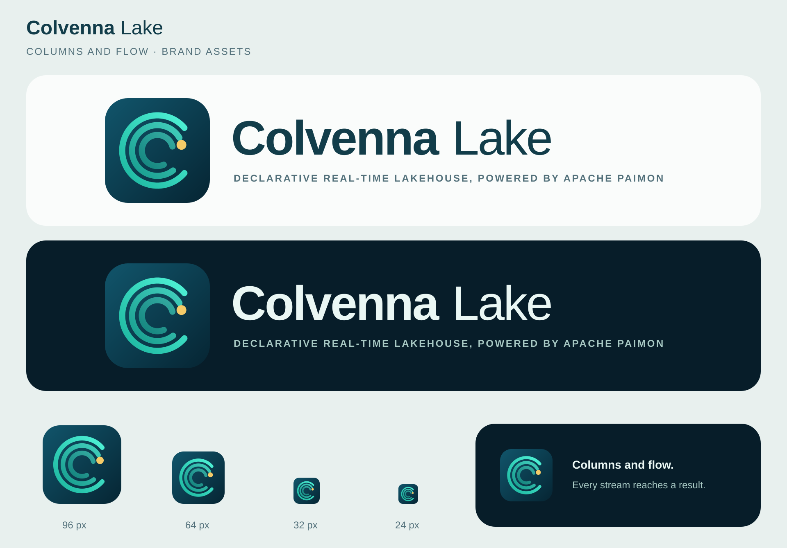

# Colvenna Lake 品牌资产

图形是 Colvenna 系列的主标识：三条同心的青绿流线组成 Colvenna 的 “C”，最内一条流向金色结果点，表达“列与流”：持续流动的数据汇入查询结果。系列各产品沿用同一图形，只换字标（定稿见 colvenna-for-clickhouse#28，生成脚本的原版在 colvenna-for-clickhouse 的品牌资产）。

本产品的字标中 “Colvenna” 用粗体，是主品牌；“Lake” 用常规字重，是从属的描述。横向标志的副标题行是英文副标题的大写形式（见下文“名称与副标题”）。图形独立绘制，不使用也不仿制 Apache Paimon、Apache Flink、Apache Doris 等第三方项目的 Logo，也不使用 ASF 的羽毛标志。



| 文件 | 用途 |
| --- | --- |
| [logo-light.svg](logo-light.svg) / [PNG](logo-light.png) | 白色或浅色背景上的横向标志 |
| [logo-dark.svg](logo-dark.svg) / [PNG](logo-dark.png) | 深色背景上的横向标志 |
| [icon.svg](icon.svg) / [PNG](icon.png) | 应用图标、头像与紧凑场景 |
| [brand-preview.svg](brand-preview.svg) / [PNG](brand-preview.png) | 自包含的品牌预览：浅色与深色标志，96、64、32、24px 的图标 |
| [generate.py](generate.py) | 生成以上全部 SVG（加 `--png` 时也生成 PNG） |

## 配色与使用

| 元素 | 颜色 |
| --- | --- |
| 深蓝底色 | `#11556B` → `#062533` |
| 青绿流线 | `#1BB59E` → `#4FF2D6` |
| 结果点 | `#F5CB68` |
| 浅色版字标、副标题 | `#123D4A`、`#52707A` |
| 深色版字标、副标题 | `#EAF7F4`、`#A8C9C4` |

- 保持原始比例，四周留出至少图标宽度 1/8 的空白。
- 横向标志是 720 × 160；显示宽度不小于 480px，再窄副标题就看不清，改用图标。
- 独立图标不小于 24px。2026-10-24 按 96、64、32、24px 渲染，放在浅色与深色背景上目视检查：24px 下 “C” 形的流线仍可辨认，金色结果点变小但还看得见。
- SVG 自包含，不引用外部资源，`brand-preview.svg` 也一样。字标使用 Arial、Helvetica 与系统无衬线字体回退，字形随查看者的字体略有差异；画布宽度按 Arial 的字宽留出余量。PNG 透明背景（预览除外）。

本项目的品牌资产采用 [Apache License 2.0](../../LICENSE)。

> Apache, Apache Paimon, Paimon, Apache Flink, Flink, Apache Doris and Doris are either registered trademarks or trademarks of The Apache Software Foundation in the United States and/or other countries. No endorsement by The Apache Software Foundation is implied by the use of these marks.

标志里没有、也不仿制 Apache 项目的 Logo 或 ASF 的羽毛；各项目名称的使用规则见[商标与命名](../../release/trademarks.md)。

## 名称与副标题

系列各产品的名称、副标题、描述与命名规则，以 Colvenna 系列索引 为唯一来源；系列的其他产品也列在那里。本产品：

- 名称：**Colvenna Lake**
- 副标题：基于 Apache Paimon 的声明式实时湖仓 / *Declarative real-time lakehouse, powered by Apache Paimon*

名称与副标题成对出现在 [README](../../README.md) 的标题下、横向标志的副标题行与文档首页（[用户手册](../../docs/manual/user.md)）；仓库描述以副标题开头。副标题只说明产品是什么，不承担商标作用；其中的 Apache 项目写全称，所在页面附 ASF 商标署名。修改时先更新索引，再同步到本仓库。

## 名称与商标

产品原名 Cove Lake，2026-10-24 随系列主品牌改为 Colvenna Lake（#258），2026-10-25 技术标识也随之改名（#271）。为什么放弃 Cove、Colvenna 的初筛结果，以及技术标识怎样改名，见[商标与命名](../../release/trademarks.md#7-产品名从-cove-lake-到-colvenna-lake)第 7 节。

**状态：Colvenna 的律师完整检索与商标申请尚未执行，记为 `WAIVED_BY_REQUESTER_NOT_PASS`。** 请求者决定先行采用这个名字，不表示名称已经过清查；它不作为 v1.0 的发布门槛（请求者的决定，colvenna-for-clickhouse#30），仍建议尽早完成。

## 重新生成

在仓库根目录执行：

```bash
python3 assets/brand/generate.py          # 只生成 SVG
python3 assets/brand/generate.py --png    # 同时用 rsvg-convert 生成 PNG
```

PNG 的尺寸写在 `generate.py` 的 `PNGS` 里：横向标志 1440 × 320，图标 512 × 512，预览 1920 × 1340。`rsvg-convert` 按机器上的字体渲染，生成 PNG 的机器要有与 Arial 等宽的字体（Arial、Arimo 或 Liberation Sans）。同一台机器上连续运行两次，产出的文件逐字节相同。

> 注：本文中的 issue 与 PR 编号（如 #258）是本项目早期私有仓库的编号，本仓库里没有对应的页面。
