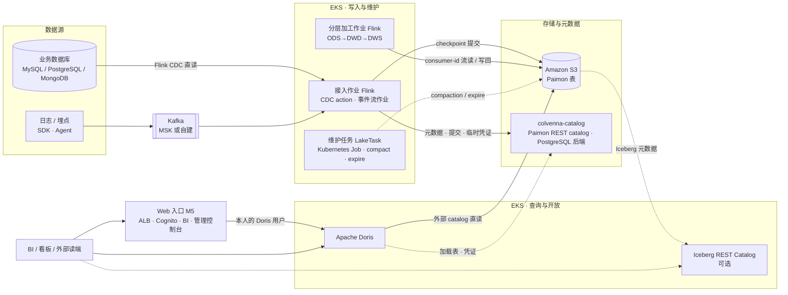

# Colvenna Lake 实时湖仓 High-Level Design

## 1. 文档目的与范围

本文描述 Colvenna Lake 实时湖仓的总体设计：目标、约束、分层架构、关键技术选型及其依据、两类数据接入链路（数据库 CDC 与实时事件流）、存储与元数据设计、查询与服务层、运维与安全、容量边界、风险与验证计划。

本文是 HLD，不包含具体表清单、字段级模型、作业级参数清单和运维手册，这些留给 LLD 与 runbook。技术事实的出处与未验证项见 `docs/research/`；M0 的访问边界、量化目标、回刷与删除契约见 [`acceptance-contract.md`](acceptance-contract.md)。本文的版本、延迟和恢复数字都是设计目标，不能代替 M1/M2 实测。

### 1.1 非目标

- 不提供离线数仓向湖仓的迁移方案。
- 不覆盖机器学习特征平台与向量检索（Paimon 2.x 已有多模态能力，作为后续扩展项列在第 15 节）。
- 不承诺亚秒级端到端延迟；本方案的可见性下限是 Flink checkpoint 间隔。

## 2. 需求与约束

### 2.1 业务需求

| 编号 | 需求 | 说明 |
| --- | --- | --- |
| R1 | 实时接入业务数据库变更 | MySQL / PostgreSQL 等 CDC，支持 insert / update / delete；源端到 Doris ODS 外表稳态 p95 目标 5 分钟，按第 16 节实测 |
| R2 | 实时接入事件流 | 日志、埋点等 append-only 事件，高吞吐 |
| R3 | 湖仓一体 | 同一份数据既承担实时管道又承担分析查询，不再单独维护数仓副本 |
| R4 | 流批一体的分层加工 | ODS → DWD → DWS 全部在湖内完成，下游可继续流式消费 |
| R5 | 交互式分析 | BI 与看板秒级响应；ad-hoc 查询可接受更长时间 |
| R6 | 对外开放 | 允许外部工具以开放格式读取，不锁定单一引擎 |

### 2.2 技术约束

| 编号 | 约束 | 来源 |
| --- | --- | --- |
| C1 | 对象存储使用 Amazon S3，S3 费用不是约束 | 用户决定 |
| C2 | 计算层运行在 Kubernetes（Amazon EKS），不使用 EMR 等托管大数据服务 | 用户决定 |
| C3 | 架构须可移植到其他云，优先使用云中立组件与 S3 兼容接口 | 用户决定 |
| C4 | 验证环境直接使用真实 S3，不用 MinIO 模拟 | 用户决定 |

## 3. 总体架构

### 3.1 架构总图

静态架构图见 `assets/architecture/colvenna-lake-architecture.svg`（Mermaid 源与生成脚本在同目录），交互式版本见 `docs/design/diagrams/colvenna-lake-architecture.html`。文本版如下：

### 3.2 分层职责

| 层 | 组件 | 职责 |
| --- | --- | --- |
| 数据源 | 业务数据库、应用 SDK / Agent | 产生 binlog / WAL 与事件 |
| 消息层 | Kafka，外部依赖（Amazon MSK、Confluent 或 Strimzi 自建） | 仅承载事件流；平台不创建生产 Kafka，通过 bootstrap 地址与认证接入；开发用的 `tests/fixtures/kafka/colvenna-dev-kafka` 在已有的 Strimzi operator 上装单节点 Kafka，仅供开发与 PoC；CDC 默认不经过 Kafka，见 7.6 |
| 计算层 | Flink Kubernetes Operator + Kubernetes Job | Operator 托管常驻接入与分层作业；回刷、维护与质量校验是一次性的 `LakeTask`，以 Kubernetes Job 运行有终态的 Flink 批作业。M3 没有常驻的维护作业 |
| 存储层 | Amazon S3 上的 Paimon 表 | 业务明细的权威副本，ODS / DWD / DWS 全部为 Paimon 表；Doris 派生结果与备份另行登记 |
| 元数据层（控制平面） | colvenna-catalog：自研的 Paimon REST catalog 服务端，PostgreSQL 后端 | 发布版 REST 目录操作、快照原子提交、按表下发临时存储凭证、服务身份的库表授权与审计；设计中的轻量模式（Paimon JDBC catalog + jdbc 锁）未交付，JDBC catalog 只在 M1 PoC 用作脚手架 |
| 查询层 | Apache Doris | 直读 Paimon 服务 BI 与 ad-hoc；多 catalog 承担联邦查询；Compute Group 隔离负载（M3 交付为存算一体，Compute Group 未部署验证，见 10.1）。Trino 不在默认栈，见 10.2 |
| 开放层 | Iceberg 兼容模式 + 自建 Iceberg REST catalog（可选） | 让只认 Iceberg 的外部工具读同一批数据文件 |
| 平台层 | colvenna-catalog、colvenna-operator、Flink Kubernetes Operator、Doris Operator、PostgreSQL；另有 Web 入口（ALB、Cognito）、管理控制台与 BI 查询界面 | 平台组件为 K8s 原生部署方式：Colvenna Lake 自有的组件以 `deploy/helm/` 的 chart 安装，colvenna-catalog 以 Colvenna Catalog 发布的 chart 安装（6.3），Flink Kubernetes Operator、Doris Operator 与 Doris 由 `deploy/scripts/` 的脚本安装；PostgreSQL 是 RDS 实例（`deploy/aws` 的 CDK 栈），Web 入口用 AWS 托管服务；`deploy/install.sh` 按顺序装完整套 |

### 3.3 关键设计决策一览

| 决策 | 选择 | 主要理由 | 详见 |
| --- | --- | --- | --- |
| 表格式 | Apache Paimon 2.x | 唯一提供完整 changelog 流读与内建 merge engine 的开放表格式 | 4.1 |
| 计算引擎 | 首版流批均用 Flink；Spark 待容量或能力缺口触发单独验证 | 私有 S3 上的有限历史更正、分区覆盖与 compaction 已由 Flink 批模式验证；跨层收敛与容量由 #15/#16 按 Flink 路径结项，Spark 专项未触发 | 4.2、9.3 |
| Catalog（控制平面） | REST-first：自研 colvenna-catalog 实现 Paimon REST 契约，PostgreSQL 后端；JDBC catalog 仅作 PoC 脚手架（轻量模式未交付） | REST snapshot commit 为 S3 多写者提供原子发布路径；按表凭证限定对象路径，但终端用户列/行权限仍须可信引擎执行；JDBC catalog 没有服务端权限 | 6、12 |
| 查询引擎 | 仅 Doris；Trino 按需接入 | Doris 对 Paimon 支持最深（DV、增量读、系统表、time travel）且多 catalog 与 Compute Group 可覆盖联邦与隔离（M3 交付为存算一体，Compute Group 未部署验证，见 10.1）；Trino 容错执行的连接器列表不含 Paimon，第二引擎只增加验证与权限面 | 10 |
| CDC 路径 | Flink CDC 直连，不经 Kafka | 单一消费方时 Kafka 无增益；Paimon 表本身承担层间队列 | 7.6 |
| 事件流路径 | Kafka → Flink 流作业（M3 为 Operator 生成的 DataStream 作业）→ append 表 | 削峰与多消费方；append 表无主键、水平扩展 | 8 |
| Kafka 边界 | 外部依赖（BYO），平台不创建生产集群；开发用 chart `colvenna-dev-kafka` 附带 Strimzi 单节点 Kafka | 仅事件流需要；多数用户已有 MSK 等托管服务；Kafka 运维域独立于湖仓；按协议接入天然多云 | 3.2、8.1 |
| 维护 | 直读 binlog / WAL 的 CDC（MySQL、PostgreSQL）与事件流写入作业 write-only，由按需的维护任务（`LakeTask`）压缩与过期；lookup changelog 的表（分层表、MongoDB 与经 Kafka 的 CDC）由写入端自己压缩 | 官方推荐；避免写入与 compaction 争资源和文件级冲突；lookup changelog 依赖写入端压缩 | 11 |
| 对外开放 | Iceberg 兼容模式发布到自建 REST catalog | 云中立；Glue 仅在需要 Athena 时作为可选发布目标 | 10.3 |

## 4. 技术选型依据

### 4.1 表格式：为什么是 Paimon

对比报告 `docs/research/paimon-vs-iceberg-vs-hudi.md` 第 5 节给出了三者流式能力的官方边界：

- Iceberg 官方文档写明 Flink 流读 "CDC read is not supported yet"，Spark 增量读只包含 append 快照。
- Hudi 的 Flink changelog 模式对中间变更是 best-effort。
- Paimon 通过 `input` / `lookup` / `full-compaction` 三种 changelog producer 产出带前镜像的完整变更流，并内建 deduplicate / partial-update / aggregation / first-row 四种 merge engine。

R1 与 R4 要求下游能继续流式消费带前镜像的变更，这是决定性差异。代价是 Paimon 的引擎生态以 Flink 与 Spark 为中心，外部引擎多依赖 Iceberg 兼容层，本文用第 10 节的开放层弥补。

若未来核心读端变为 Snowflake、BigQuery、Athena 等云数仓，或团队转为纯 Spark 批处理栈，应重新评估 Iceberg（见对比报告第 12 节选型决策表）。

### 4.2 计算引擎：Flink 为主

Paimon 主仓库维护 Flink、Spark、Hive 三个 connector。CDC action、lookup join、consumer-id 流读、Query Service 等实时能力只在 Flink 连接器中提供。首版批任务也选 Flink：M1 已在私有 S3 上验证有限主键历史更新/删除、append 分区覆盖与独立 compaction。大规模回刷、并发围栏和跨层收敛由 #15/#16 验收，均按 Flink 路径结项（[#15](../history/m1/backfill-convergence.md)、[#16](../history/m1/capacity-baseline.md)），M3 交付了带围栏的回刷任务（[验收](../history/m3/lake-tasks.md)）；Flink 在这些门禁失败时才单独验证 Spark，这一条件没有触发，首版不安装 Spark 或 Spark Operator。

### 4.3 版本基线

以下是 M1–M5 固定使用的正式版，各组合的验收范围以对应里程碑的验收文档为准；M0 时的候选依据（发布标签提交号、源代码和发布文档）见 [M0 跨组件能力矩阵](../research/version-capability.md)。M1 的“Paimon 2.x DV + Doris JDBC”退出条件不因退回 1.4.x 而自动通过。

| 组件 | 版本 | 说明 |
| --- | --- | --- |
| Paimon | 2.0.0 | M1 数据平面与 M2 REST 契约基线，M1–M5 均以此版本验收；1.4.2 仅是失败后的重评估分支，未启用 |
| Flink | 1.20.4 | Paimon 2.0.0 CDC 模块编译基线；M1 的 24 小时基线与 M2–M5 的验收都在此版本上运行 |
| Flink Kubernetes Operator | 1.16.1 | 托管常驻作业；colvenna-operator 使用同版本的 `FlinkDeployment` API |
| Flink CDC | 3.5.0；MySQL connector 3.7.0-1.20 | Paimon 2.0.0 CDC action 的依赖基线，不用 Flink CDC YAML pipeline sink 替代。MySQL 的 SQL connector 自 M3 [#113](../history/m3/flink-cdc-3.7.md) 起换成 3.7.0-1.20：它修复了新增源表 failover 后丢数（FLINK-40741）；PostgreSQL、MongoDB 共用的 flink-cdc-base 在 3.7 没变，仍是 3.5.0 |
| Doris | 4.1.4 | JDBC Paimon catalog 从 4.1.0 起标为实验性；4.1.4 内置 Paimon **1.4.2**，读 2.0.0 DV 表判为 RED、不可用。M1 结项改用在官方镜像上自建的 Paimon 2.0.0 读取器（SDK2 读取器），前提是 catalog 设 `meta.cache.paimon.table.ttl-second=0`（[结项判定](../history/m1/doris-paimon.md#结项判定)）；M2 的 REST 通用 bearer 与按表凭证已验收（见 6.4）。以 Doris Operator 25.8.0 部署。平台分发的是这个修改构建，以查询引擎镜像的名义（仓库 `query-engine`），不以 Doris 命名（[商标与命名](../../release/trademarks.md)） |
| Spark（后续候选） | 3.5.8 | 首版不部署；#15/#16 按 Flink 路径结项，Spark 专项未触发。M2 只用作 REST 验证客户端，M4 用作外部 Iceberg 读端 |
| StarRocks（评估备用，未启用） | 4.1.3 | 发布文档只列 filesystem/Hive Paimon catalog，不能直接代替 JDBC/REST 查询路径；M1 结项判定不启动对照 |
| PostgreSQL | 14+ | colvenna-catalog 后端（AWS 上为 RDS for PostgreSQL 16）；M1 PoC 的 JDBC catalog 也用它（锁方言支持 MySQL / PostgreSQL / SQLite），轻量模式未交付 |
| colvenna-catalog | 对齐 Paimon 2.0.0 的 REST Catalog 契约 1.0（OpenAPI 3.1.1） | M2 自建服务端及自有授权管理面；上游 REST Management API 仅见于 master，不能按已发布接口实现 |
| Apache Polaris | 1.8.0 | M4 开放层的 Iceberg REST 发布目标（10.3） |
| Marquez | 0.51.1 | M4 血缘验收用的 OpenLineage 目录（12.6），目录由用户选择 |
| Apache Superset | 6.1.0 | M5 的 BI 查询界面（10.1） |
| Strimzi / Kafka | 1.2.0 / 4.3.1 | 仅开发用的单节点 Kafka（`colvenna-dev-kafka`）；生产 Kafka 由用户提供 |

## 5. 存储层设计

### 5.1 S3 布局

- 一个专用桶承载 Paimon warehouse，路径形如 `s3://<bucket>/warehouse/<db>.db/<table>/`。Paimon 的分区目录天然形成多个 S3 前缀，AWS 官方每前缀每秒至少 3500 次写、5500 次读的速率随前缀数水平扩展。
- Flink checkpoint 与 savepoint 落同一桶的独立前缀，计算层完全无状态。
- 桶级配置：关闭版本控制（Paimon 自己管理快照与文件过期，版本控制只会保留已删文件并干扰孤儿文件清理）；开启 SSE-S3 或 SSE-KMS；配置 `AbortIncompleteMultipartUpload` 生命周期规则（Paimon 的 S3 写入走 multipart upload，作业异常退出会留下未完成分片）。
- M2 目标是由 colvenna-catalog 按表签发临时凭证；colvenna-catalog 自身与 M1 JDBC 模式下的 Flink、Doris 通过 IRSA（IAM Roles for Service Accounts）获取角色，不在配置中写静态密钥。Doris 是否完整使用 REST 凭证下发须验证，未经验证不得把该路径用于敏感表。M2 已验收 Doris 经 `/token` 取得与续期按表凭证；单个查询跨越凭证过期与 query-auth 未验证（见 6.4）。

### 5.2 Paimon 在 S3 上的提交语义（关键约束）

调研报告第 13.1 节核实：Paimon 的 `S3FileIO` 没有覆写原子写方法，快照提交沿用"写临时文件再 rename"；Hadoop S3A 文档明确 rename 不能作为提交算法的依据；Paimon 快照提交源码注释写明对象存储上需要额外的锁保护。只有阿里云 OSS 的实现用了条件写，S3 实现没有使用 S3 已支持的 If-None-Match。

结论：**在 S3 上，同一张表只要有多个写入方（包括"接入作业 + 维护作业"这一官方推荐组合），快照发布就必须由 catalog 保证原子性。** Paimon 提供两条路：catalog 支持快照版本管理时委托给 catalog（REST catalog 的 snapshot commit API），否则用 Hive / JDBC catalog 的共享锁。本方案选 REST 路径，由 colvenna-catalog 服务端做原子发布；设计中的轻量模式退回 JDBC 锁，未交付。这是第 6 节 catalog 选型的直接原因，也是本方案与 HDFS 部署最大的差异。

### 5.3 多云可移植

Paimon 的 S3、GCS、Azure、COS、OBS 五个对象存储实现都沿用 rename 路径，提交行为一致，因此"由 catalog 服务端做原子发布"是跨云统一的答案，客户端不依赖任何一家对象存储的条件写。colvenna-catalog 服务端发布 snapshot 文件时需要对象存储提供原子的不存在才创建：S3 用 `If-None-Match: *`，GCS、Azure Blob 与 OSS 有等价的条件写。服务端每个桶第一次发布前会探测，不支持的存储直接拒绝提交，见 [colvenna-catalog LLD](https://github.com/colvenna/colvenna-catalog/blob/v1.0.0-rc.1/docs/design/colvenna-catalog-lld.md#提交协议)。移植到其他云时，这是控制平面除凭证下发外唯一需要按云适配的点。迁移到其他云时，使用其 S3 兼容端点，只需改 `s3.endpoint`、凭证与 path-style 访问开关，表结构、catalog 配置、作业定义不变。以上是设计：第二朵云（#33）未开展，多云移植未验证，见第 13 节。

## 6. 元数据与 Catalog 设计：colvenna-catalog（REST-first）

### 6.1 决策与理由

Colvenna Lake 自研 **colvenna-catalog**：实现 Paimon REST catalog 契约的服务端，PostgreSQL 做元数据后端。它是产品的控制平面，也是最大的单项工程投入。它在 M2 由本仓库开发，现在是独立产品 [Colvenna Catalog](https://github.com/colvenna/colvenna-catalog)，在自己的仓库开发与发布（#295）。服务端是从本仓库移植过去的（`Ported-from: colvenna-lake@33eb4b54`）；按 Colvenna Catalog v1.0.0-rc.1 的[改名记录](https://github.com/colvenna/colvenna-catalog/blob/v1.0.0-rc.1/docs/rename.md)，移植时 HTTP 契约、配置名、指标名与迁移链（`V1`、`V2`）都与 Colvenna Lake 原有的相同。本仓库没有逐项比对，只核对其中几项：以 Colvenna Lake 原有 chart 的全部取值渲染 catalog 的 chart，生成的对象与 ConfigMap 里的 `COLVENNA_*` 配置名与原来的相同（`tests/acceptance/test_catalog_chart.py`，给出 chart 包时才渲染）；数据库的 schema 版本等于固定版本记下的 `schema_version`（`deploy/scripts/catalog/check-health.sh`）；HTTP 契约由 UAT-CAT-01 到 12 在装好的环境上以 Colvenna Lake 的引擎与脚本验收；指标名只核对 `colvenna_catalog_commits_total`（UAT-MON-01）。Colvenna Lake 按 digest 使用它发布的服务端镜像与 Helm chart，现在固定的版本是 v1.0.0-rc.1（[`deploy/images/colvenna-catalog.json`](../../deploy/images/colvenna-catalog.json)），部署见 6.3。实现设计见该版本的 [colvenna-catalog LLD](https://github.com/colvenna/colvenna-catalog/blob/v1.0.0-rc.1/docs/design/colvenna-catalog-lld.md)。

| 方案 | 结论 | 依据 |
| --- | --- | --- |
| 自研 Paimon REST catalog 服务端（colvenna-catalog） | **采用** | 官方没有可部署的 Paimon REST 服务端。REST 的 snapshot commit API 解决 S3 多写者提交问题；按表凭证可约束对象访问路径。终端用户权限仍取决于引擎执行与无旁路配置，见 M0 验收契约 |
| Paimon JDBC catalog on PostgreSQL + `lock.type=jdbc` | M1 PoC 脚手架；轻量模式未交付 | 今天即可部署；但零权限模型，权限只能落在引擎层与 S3 prefix IAM |
| Hive catalog + 自建 HMS | 不采用 | 多一套 HMS，且同样零权限 |
| Hive catalog 以 Glue 为后端 | 不可行 | Glue Hive 客户端的 lock 调用直接抛不支持异常 |
| 现成的 Iceberg catalog（Polaris / Lakekeeper / Gravitino Iceberg REST） | 只作为 Iceberg 兼容发布的目标 | 均不实现 Paimon 契约 |

### 6.2 colvenna-catalog 的能力范围

| 能力 | 1.0 | 说明 |
| --- | --- | --- |
| 发布版 Catalog API：`GET /v1/config`，database / table / commit / token，以及目标 Flink、Spark、Doris 实际用到的 view、function、partition、branch、tag、consumer 路径 | M2 目标客户端所需路径必做 | 以 Paimon 2.0.0 OpenAPI 和客户端实际调用核定操作集合；master 上统计的操作数不能当成发布版必需能力或已实现能力，缺失调用则 M2 不通过 |
| Snapshot commit / rollback / snapshots 列表 | 必做 | 服务端原子发布，取代 S3 rename 与 JDBC 锁；这是 REST-first 的首要收益 |
| 认证：bearer token；principal 由服务端定义 | 必做 | Paimon 客户端支持 `token.provider=bear` |
| 凭证下发：`token` 端点按表签发前缀级临时 S3 凭证（对接 STS；多云时对接各云 STS 等价物） | 必做 | 约束对象路径和有效期；必须验证客户端没有其他宽 S3 凭证 |
| 服务身份的库 / 表授权 | M2 必做 | colvenna-catalog 自有、单独版本化的管理面存储 grants；在 Paimon 2.0.0 已发布的 list/load/commit/token 路径执行允许/拒绝。上游 Management API 的 permission/column 接口不在 2.0.0 发布版内 |
| 终端用户列级判定 | M2 明确执行方，策略验证后开放 | Doris 的用户列权限必须逐入口验证；colvenna-catalog 可登记需求，但不能把未发布的 Paimon Management API 列 grant 或表前缀凭证表述为已强制的列级保护 |
| 审计字段：owner、created_by、updated_by 写入 `sys.tables` 与 `$partitions` | 必做 | 只有 REST catalog 才会填充这些字段 |
| 服务端审计日志：谁在何时对哪张表做了什么 | 必做 | 补齐 JDBC 模式下只有 `commit.user-prefix` 的空白 |
| 上游 Management API 的 column grant / row filter / column mask | 后置，需正式发布版 | 仅见 Paimon master 的实验性独立契约；先等正式发布，再验证引擎 `AuthTableQuery` 与系统表/旁路路径，不能直接接入 Paimon 2.0.0 客户端 |
| 上游 Entity label | 后置，需正式发布版 | 2.0.0 无该管理接口。M3 起分类写在 `LakeSource`、`LakeTable` 的 `spec.governance`，table option 只镜像负责人（`colvenna-lake.owner`） |

### 6.3 部署与运行

- 无状态服务，多副本部署在 EKS 写入节点组，前置 Service；状态全部在 PostgreSQL（生产用 RDS 多可用区或各云托管 PostgreSQL，集群内 PostgreSQL 仅供开发）。
- 所有写同一张表的作业必须通过同一个 colvenna-catalog 实例组提交，这是原子发布的前提；轻量模式下则必须使用完全相同的 JDBC catalog 与锁配置。
- Catalog 契约版本与 Paimon 客户端版本绑定：升级前在 branch 上验证兼容性。服务身份授权的自有管理面单独版本化并测试；master 的 Management API 为实验性且不属于 2.0.0 发布版，待正式发布再决定迁移。
- colvenna-catalog 以 Colvenna Catalog 发布的 Helm chart 部署，AWS 上由 `deploy/scripts/catalog/` 的脚本驱动，不在本仓库构建：
  - `fetch-catalog.sh` 按 `deploy/images/colvenna-catalog.json` 从发布仓库（`COLVENNA_RELEASE_REGISTRY`）按 digest 把服务端镜像复制进环境自己的仓库 `colvenna-lake-<env>/colvenna-catalog`，按 digest 拉取 chart（OCI），并核对两者都由这个版本的源码提交（`built_from`）构建：镜像的标签 `org.opencontainers.image.revision`，chart 的注解 `colvenna-catalog/source-commit`；
  - `install-catalog.sh` 以 Colvenna Lake 的取值安装这个 chart。命名空间、release 与服务账号 `colvenna-catalog`、各 Secret、数据库与账号 `colvenna_catalog` 都沿用原来的名字，已有环境原地接管，元数据、token 与授权不变；
  - 服务端角色与数据角色仍由 Colvenna Lake 的 catalog 栈（`deploy/aws/src/catalog-stack.ts`）创建：catalog 的 CDK 应用不是可以按 digest 取用的发布物。两个角色的信任、会话时长与授权和 Colvenna Catalog 自己的 EKS 栈相同，只多一项：也可以列举不带斜杠的 `warehouse` 前缀（本仓库 M2 以来的授权）。CDK 测试（`catalog-roles.test.ts`）比对二者；
  - 按候选安装时，镜像与 chart 取自候选在 Colvenna Lake 发布仓库里的副本（`colvenna-lake-release/colvenna-catalog`、`colvenna-lake-release/charts/colvenna-catalog`），digest 相同，候选的清单记录它们（见 [`release/README.md`](../../release/README.md)）。
- 原计划的轻量配置（JDBC catalog，供不需要治理能力的场景）与 M3 CLI 封装的 `colvenna install`、`--profile lite` 都未交付：`colvenna` CLI 只经 Kubernetes API 提交与读取声明（见 6.6），平台组件仍以 chart 安装。

### 6.4 引擎接入与验证项

| 引擎 | 接入方式 | 验证状态 |
| --- | --- | --- |
| Flink、Spark | Paimon 连接器 `metastore=rest`、`uri`、`token.provider=bear`、`token` | M2 已验收：Flink 写入与 Spark 批作业经 REST 读写，按表凭证的获取、续期与跨表拒绝（[EKS 验收](../history/m2/catalog-on-eks.md)） |
| Doris 4.1.4 | M1 用 `paimon.catalog.type=jdbc`；M2 用 `paimon.catalog.type=rest` | JDBC 在发布版文档标为实验性；REST 通用 bearer、自建服务端、`paimon.rest.data-token.enabled=true` 的 `/token` 调用 M2 已验收（[EKS 验收](../history/m2/catalog-on-eks.md)、[切换](../history/m2/jdbc-to-rest-switch.md)）；query-auth 未验证，M4 #35 保持关闭 |
| CDC action | `--catalog_conf metastore=rest` 等 | M2 已验收：切换时 M1 的 CDC 作业挂起，经 REST 的作业（同一个 `MySqlSyncDatabaseAction`）从 M1 已提交的 binlog 位点续写（[切换](../history/m2/jdbc-to-rest-switch.md)） |

M1 以 Paimon 2.0.0 + Doris 4.1.4 的 JDBC catalog 验证数据与查询。M2 的 colvenna-catalog MVP 再替换 JDBC，并独立验证 REST bearer、服务端 commit 与 `data-token.enabled=true` 下的实际 `/token` 请求和对象访问；M1 的 JDBC 通过不证明 M2 的 REST 通过（M2 的结果见上表），具体前提见 [版本矩阵](../research/version-capability.md#可执行版本前提与验证顺序)。

身份传递、各读入口与绕过路径的矩阵见 [M0 验收契约第 1 节](acceptance-contract.md#1-身份授权和绕过路径)。Doris 若只持有统一服务 token，catalog 不能识别 Doris 终端用户；若通用 bearer 或凭证下发验证失败，敏感表不得以 JDBC/filesystem 旁路替代 REST 目标。

### 6.5 元数据缓存与查询侧

Doris 对 Paimon 最新 snapshot 与 schema 的缓存 TTL 影响查询看到新快照的延迟；候选刷新/TTL 配置必须结合 DV 维护和实际查询在 M1 验证（见 12.5 与 M0 验收契约第 2 节）。M1 的结论：catalog 设 `meta.cache.paimon.table.ttl-second=0`，这是 SDK2 读取器方案的前提（[结项判定](../history/m1/doris-paimon.md#结项判定)）；平台 Doris 的 Paimon catalog 由 Operator 按此创建。

### 6.6 实现语言与构建边界

项目自有可执行程序采用 **Java 与 Go 两种语言**。SQL、YAML 与 Helm values 是数据定义和部署配置，不引入第三种应用实现语言。唯一的例外是 BI 查询界面（M5）：它的扩展运行在 Apache Superset 的进程里，只能用 Superset 的语言 Python，范围限于身份、连接与元数据浏览的钩子（见下表）。各组件的版本与责任如下：

M1 在指定 AWS 账号和区域创建 PoC 环境的基础设施代码采用 TypeScript CDK；M2–M5 沿用同一方式，只建验收所需的镜像仓库、IRSA 角色与库凭证，M5 另建 Web 入口（Cognito 用户池、证书、公网 ALB）。这些代码只在部署时运行，不作为平台服务、作业、Operator 或用户 CLI 交付。这个一次性的基础设施例外不改变下表的产品实现语言；M2 仍以 Helm 安装与验收。

| 组件 | 语言与构建 | 边界 |
| --- | --- | --- |
| colvenna-catalog | Java 21 + Maven，M2；现在在 [Colvenna Catalog](https://github.com/colvenna/colvenna-catalog) 自己的仓库开发与发布，Colvenna Lake 使用其发布物（6.1） | 固定 Paimon 2.0.0 的 `paimon-core`、`paimon-format`、`paimon-s3` 依赖，优先复用 schema、snapshot、commit 等数据结构与序列化；真实 Flink/Spark/Doris 客户端仍须做 REST 兼容和原子提交测试。上游 Flink/Spark REST 集成测试可作契约用例来源，须改造为对实际 colvenna-catalog 运行，不能把测试服务端通过当作产品通过。将来若接入正式发布的 Management API，再评估复用 `Predicate`/`Transform`，不作为 M2 已有接口。Java 21 上运行 Paimon 2.0.0 依赖已由 M2 在 EKS 上验收（[验收](../history/m2/catalog-on-eks.md)） |
| colvenna-operator | Java 21 + Maven + Java Operator SDK，M3 | 使用与部署版 Flink Kubernetes Operator 匹配的 `FlinkDeployment` API jar；在服务端执行治理准入，不能依赖 CLI 检查。上游 Flink Kubernetes Operator 的 Maven 模块使用 [Java Operator SDK](https://github.com/apache/flink-kubernetes-operator/blob/de630f6f8ac0591fab2300fe56d58cdd262002a0/flink-kubernetes-operator/pom.xml)，并提供 [`FlinkDeployment` 类型](https://github.com/apache/flink-kubernetes-operator/blob/de630f6f8ac0591fab2300fe56d58cdd262002a0/flink-kubernetes-operator-api/src/main/java/org/apache/flink/kubernetes/operator/api/FlinkDeployment.java)；复用同一框架是本项目的选择 |
| Flink SQL runner 与作业入口（`colvenna-jobs`） | Java + Maven，M1 起 | 源码可用项目的 Java 21 构建环境，但输出字节码须以目标 Flink 1.20 镜像支持的 JDK 为准；默认镜像按 Java 11 构建，runner 使用 `--release 11`。Flink 1.20 [官方兼容表](https://nightlies.apache.org/flink/flink-docs-release-1.20/docs/deployment/java_compatibility/)推荐 Java 11，Java 17 为实验性支持，未列 Java 21；不把 Java 21 字节码放进该运行镜像 |
| `colvenna` CLI | Go，M3 | 薄客户端：只经 Kubernetes API 提交 CR、读取状态、建批任务与合规删除请求，操作逻辑在 `colvenna-cli/ops` 包中、与控制台共用；不封装 Helm 安装，也不调 colvenna-catalog API。分类、授权、SQL 解析和审批逻辑均在控制面。单二进制分发，CLI 故障不应放宽服务端准入 |
| colvenna-console | Go，M5 | 管理控制台的服务端，页面在服务端以 `html/template` 渲染，样式是静态 CSS，流水线全景图在服务端画成 SVG，没有前端构建；身份只认 Web 入口转发的、经验签的 token；读声明与 Prometheus 只用只读的身份；受控操作用 CLI 的 `colvenna-cli/ops` 包生成同样的对象，扮演控制台专用的两个 Kubernetes 用户提交（[Web 入口与控制台 LLD](colvenna-console-lld.md)） |
| colvenna-bi（Superset 的扩展） | Python，M5 | `colvenna_bi` 与 `superset_config.py`，以 Superset 6.1.0 的扩展点接入（`FLASK_APP_MUTATOR`、`DB_CONNECTION_MUTATOR`、SQLAlchemy 方言），另包裹 `Database.mutate_sql_based_on_config` 给每条查询加上本人的注释：每个请求验证入口的 token，每个连接换成本人的 Doris 用户，元数据浏览不用 `information_schema`。另有三个随它运行的小模块：在 Superset 的应用上下文里维护看板对应的数据库与角色的同步 sidecar、安装时建 `ColvennaBI` 角色的初始化步骤、Pod 启动时生成自签名证书的 init 容器。都用同一个镜像，不承载平台的其他逻辑（[Web 入口与控制台 LLD](colvenna-console-lld.md)） |

Operator 对 `LakeTable.upstream` 的治理校验必须以**实际解析到的上游表**为依据：使用与目标 Flink 1.20 语法/目录一致的 SQL parser/planner，对视图引用做可核验展开并与声明比对。解析失败、动态 SQL、无法证明来源的 UDF/临时表或声明不一致时拒绝发布。Flink 1.20 planner 能否在 Java 21 Operator 进程内稳定工作须实测；若不兼容，使用仍为 Java 的独立兼容 JDK 校验进程（M3 采用后者：Operator 以作业镜像起 Kubernetes Job 跑校验，见 [Operator LLD](colvenna-operator-lld.md)），保持相同的拒绝规则。

**代码检查。** 仓库级检查由 pre-commit 执行，本地与 CI 用同一份 `.pre-commit-config.yaml`；已接入 Markdown（markdownlint-cli2）、YAML 语法、GitHub Actions（actionlint），以及部署值的检查（`deploy/scripts/redaction/redaction.py`，#248：文件与提交说明里不能有本地设置里的、或以哈希存放的维护者的部署值，也不能有真实账号的 ARN、内网地址与公网地址；公网地址只有 `public-addresses.tsv` 逐项登记的例外，文档与测试用文档地址段或占位符，#300）。各语言的检查都在 `.github/workflows/lint.yml` 里：

- **Java**：Spotless 用 google-java-format AOSP 风格检查格式，与 Paimon 2.0.0 [构建配置](https://github.com/apache/paimon/blob/604e6d5e131c74a8d127333a2a3ad6d0319732bf/pom.xml)一致；Error Prone 作为编译期静态检查。二者挂在 Maven 构建上，`mvn verify` 失败即阻断，Flink SQL runner 在 `--release 11` 下同样执行。
- **Go**：golangci-lint（含 gofmt/goimports 格式检查），`colvenna-cli`、`colvenna-console` 与架构图渲染脚本（`assets/architecture/`，有自己的 `go.mod`）用同一份 `.golangci.yml`；前两者的 `check.sh` 另跑 `go vet` 与 `go test`。
- **Python**：`colvenna-bi/check.sh` 在 BI 镜像里跑 `colvenna_bi` 的单元测试并导入配置；`tests/acceptance/` 的判定脚本跑 `unittest`。没有 Python 的 lint。
- **Helm chart 与 CRD 清单**：`helm lint` 覆盖 `deploy/helm/` 下全部 chart；监控规则另由 promtool 检查。
- **部署代码**：`deploy/aws` 的 TypeScript CDK 跑 `tsc --noEmit` 与 node 测试；`deploy/` 与 `tests/` 下的 shell 脚本都跑 shellcheck。

## 7. 接入链路 A：数据库 CDC

### 7.1 路径选择

采用 Paimon CDC action（`paimon-flink-action` jar）直连源库。它底层使用 Flink CDC 3.5.0 的源连接器（MySQL 自 M3 #113 起为 3.7.0-1.20，见 4.3），在其上提供自动建表、运行中 schema 演进、整库同步、计算列、类型映射与多表 sink。三条可选路径的对比见调研报告 14.1 节；不选 Flink CDC YAML pipeline 的原因是其 Paimon sink 官方写明不支持 exactly-once，且文档只列 filesystem 与 hive 两种 catalog。

### 7.2 支持的源

| 源 | 单表 | 整库 | 约束 |
| --- | --- | --- | --- |
| MySQL 系（含 RDS / Aurora / PolarDB / MariaDB） | ✅ | ✅ | 源表必须有主键 |
| PostgreSQL | ✅ | ❌ 无库级 action | 需 replication slot；分区表需 `REPLICA IDENTITY FULL` |
| MongoDB | ✅ | ✅ | 字段映射为 STRING，以 `_id` 为主键 |
| Kafka / Pulsar 上的 CDC 事件 | ✅ | ✅ | debezium-json / canal-json / aws-dms-json 等 |
| Oracle / SQL Server / Db2 | 经 Debezium → Kafka → `kafka_sync_*` | 同左 | Paimon action 不直接支持 |

上表是 Paimon action 的能力。平台（M3）接入的是 MySQL、PostgreSQL、MongoDB，以及 MySQL 经用户 Kafka 的 Debezium JSON（7.6）；canal-json、aws-dms-json、Pulsar 与 Oracle / SQL Server / Db2 未接入。MongoDB 作业启动后新增的集合不纳入（`AddedAfterStart`，见 [Operator LLD](colvenna-operator-lld.md)）。

### 7.3 作业形态

- 每个源库一个 `mysql_sync_database` 作业，`--mode combined`。M1 对 Paimon 2.0.0 与 Flink CDC 3.5.0 的真实测试发现：运行中创建的新表可以出现目标 schema，但持续 checkpoint 后仍没有目标数据快照；从已完成的 checkpoint 进行 `last-state` 重启后才完成新表回填。新表须执行有界恢复并核对源端行集、目标快照和恢复前后 checkpoint；不得仅凭 schema 出现宣告接入成功。自动接入只适用于隔离的接入区；新表不得因此自动取得 Doris、Iceberg 或其他用户读入口，发布关口见 12.5。M3 的做法：新表落进只有本源可读的接入库（`TargetIsolated`）；声明了分类与保留的源，新表就绪后按表级 READ 自动发布给声明的 `readers`，未分类或个人数据缺主体键的不发布；平台 Doris 只服务 `LakeDashboard` 声明的对象，Iceberg 只发布 `LakeIcebergPublication` 声明的表与复核过的列。
- 以 Flink Operator 的 `FlinkDeployment` 部署：Paimon bundle、S3 模块、CDC 连接器与驱动打进镜像 lib，action jar 放 usrlib，`entryClass` 指向 Paimon 的 FlinkActions，参数经 `job.args` 传入，密码走 Kubernetes Secret。这是官方文档给出的 K8s 部署方式。M3 起 `entryClass` 是 `colvenna-jobs` 的入口（`MySqlCdcJob`、`PostgresCdcJob`、`MongoCdcJob`、`KafkaCdcJob`），在同一镜像里调用对应的 Paimon action。
- checkpoint 间隔 30～60 秒（`LakeSource` 默认 30 秒），是可见延迟的下限，不等于端到端延迟；端到端还包括捕获、提交、compaction 与 Doris 缓存，以 [M0 验收契约 2.1](acceptance-contract.md#21-测量协议) 的实测为准。不显式设置时 action 默认 180 秒。
- PostgreSQL 源每张目标表一个 `postgres_sync_table` 作业，各占一个 replication slot；库级同步需经 Kafka。

### 7.4 主键表设计

| 决策 | 选择 | 理由 |
| --- | --- | --- |
| merge engine | `deduplicate`（默认） | CDC 是完整替换行 |
| 乱序处理 | `sequence.field` 指向源库更新时间或版本号，可多字段（M3 取声明的版本列 `target.versionColumn`，默认 `version_no`，BIGINT；MongoDB 不设）；使用 `changelog-producer=input` 时，源库须在提交前拒绝回退或重复版本，并对新表复核同一约束 | Paimon 2.0.0 MySQL parser 对 UPDATE 先输出旧行 DELETE、再输出新行 INSERT；只靠 `sequence.field` 可能删除旧行后丢弃低版本新行。若 CDC 层跳过非法 UPDATE 而源库已提交，后续有效 UPDATE 的 before 镜像可能与 ODS 现有行不同，完整 changelog 仍然错误；无法保证源端约束时须另选并实测能重建目标前镜像的 changelog 策略 |
| table mode | MOW，`deletion-vectors.enabled=true` | 官方建议分析读频繁的 deduplicate 表用 MOW；Doris 对 DV 表走 native reader。M1 基线的表开了 DV；M3 的 Operator 默认不开，可经 `tableOptions` 开启，开启后不能做 Iceberg 发布（10.3） |
| changelog producer | ODS 层 `input`；由 Flink 计算产生、无前镜像的表用 `lookup` | input 写额外 changelog 文件以保留完整变更；lookup 在 compaction 时查旧行生成完整变更 |
| bucket | fixed bucket，按每 bucket 200 MB～1 GB 估算（M3 的 `target.bucket` 默认 1） | 明确并发模型；dynamic bucket 同一分区只允许一个写作业且索引占内存 |
| 分区 | 主键表默认不分区；如需分区，分区列必须包含在主键中 | 避免跨分区更新依赖 dynamic bucket 的映射索引 |
| 写入模式 | `write-only=true` | compaction 与快照过期交给按需的维护任务（`LakeTask`，见 11.1） |
| Flink 配置 | `table.exec.sink.upsert-materialize=NONE` | 防止 sink materializer 重排记录 |

`input` 变更流的源端版本契约还覆盖缺失版本与主键重用。MySQL 非严格
`sql_mode` 下，单独声明 `BIGINT NOT NULL` 可能把省略的版本写成隐式零；
源表须对正版本设置实际生效的 CHECK，并在 UPDATE 前拒绝同值与回退。
源端默认把业务主键视为不可重用：首次 INSERT 与同一事务写入不可回收的
主键保留表，删除不释放保留项，修改主键也拒绝。若业务必须重用同一主键，
须另行保证版本跨删除持续单调，并实测墓碑、前镜像和恢复；不能沿用本方案的
默认准入结论。历史表迁移保留项时必须覆盖已删除的旧键，不能只从当前行集填充。
迁移期间必须暂停源端业务写入，完成保留项与触发器核验后才恢复。

### 7.5 Schema 演进边界

支持加列、字符串与二进制加长、整数与浮点同族加宽（M1 实测加列、`VARCHAR` 加长、`INT→BIGINT`、`FLOAT→DOUBLE`；二进制列须先为 MySQL 源配置 Debezium 的 base64 二进制处理并复测，否则写入端拒收该行、整库作业失败，未验证前不纳入含二进制列的表）；非字符串到字符串需显式允许。删列时 Paimon 保留原列，改列名被视为新增列，改表名不改 Paimon 表，主键与分区键不迁移，不兼容变更会使作业失败而非静默忽略。这些边界需在接入前与业务方确认。加列的**存储演进**不等于**授权发布**：任意未复核新列在所有用户读端默认不可见，具体围栏见 12.5。

### 7.6 是否经过 Kafka

默认不经过。Paimon CDC action 直连源库，Paimon ODS 表以 `changelog-producer=input` 保存完整变更，下游作业带 `consumer-id` 流读，Paimon 表本身承担层间队列。出现以下情形之一时在源库与 Flink 之间加 Kafka：同一 binlog 有多个异构消费方且 DBA 限制连接数；需要独立于源库 binlog 保留期的回放缓冲；源是 Oracle / SQL Server / Db2（平台未接入）。M3 只支持 MySQL 经 Kafka 的 Debezium JSON。加入后 Paimon 侧只需把 action 换为 `kafka_sync_database`，表结构与下游不变。Kafka 可能重复或乱序投递，所以经 Kafka 写入的 ODS 表改用去重的 `lookup` changelog，并由写入端压缩，不再是 7.4 的 `input` 加 `write-only`；切换方式见 colvenna-operator LLD 的 "Kafka 承载的 CDC"。

## 8. 接入链路 B：实时事件流

### 8.1 路径

SDK / Agent → Kafka（每类事件一个 topic）→ Flink 流作业（M3 为 Operator 生成的 DataStream 作业 `KafkaEventJob`）→ 按时间分区的 Paimon append 表 → 维护任务（compact `LakeTask`）治理小文件 → Doris 查询；下游按需把该表当队列流读。

Kafka 由用户提供。平台通过 `LakeSource` 中的 bootstrap 地址、认证方式与 topic 接入 Amazon MSK、Confluent 或 Strimzi 自建集群；Operator 以源自己的 Kafka 用户探测连通性、topic 与读权限，结果写进 `status.kafka` 与条件 `SourceReady`，用 `colvenna describe` 查看（原计划的 `colvenna doctor` 未交付）。开发用的 `tests/fixtures/kafka/colvenna-dev-kafka` 在已有的 Strimzi（CNCF 孵化项目）operator 上装单节点 Kafka（`tests/fixtures/kafka/dev-kafka.sh`），仅用于开发与 PoC，不用于生产。1.0 只支持 Kafka 协议；Pulsar 与 Kinesis 作为后续可扩展的事件流类型。

事件里必须带事件时间字段，分区与 watermark 都依赖它。埋点字段频繁变化时可改用 `kafka_sync_table` 加 `value.format=json`，自动建无主键表并随事件自动加列，代价是缺类型的字段映射为 STRING。M3 未接入 `kafka_sync_table`：事件字段在 `LakeSource` 中声明，未声明的字段在 `unknownFields: keep`（默认）时存进 `extra_json`；声明里追加的可选字段由 Operator 加列。

### 8.2 append 表设计

| 决策 | 选择 | 理由 |
| --- | --- | --- |
| 布局 | `bucket=-1`（unaware-bucket） | writer 间无 bucket 约束，写入随并行度水平扩展 |
| 分区 | `dt` 或 `dt,hr` | 分区即 S3 前缀，分散写入热点；分区裁剪是第一层过滤。M3 默认 `dt`，`partitioning: hourly` 时 `dt,hr`，由声明的事件时间按 UTC 推出 |
| 目标文件 | `target-file-size` 256 MB 以上 | 控制文件数。M3 不默认设置，可经 `tableOptions` 声明 |
| 写入模式 | `write-only=true` | 小文件合并与快照过期交给按需的维护任务（`LakeTask`） |
| 分区过期 | `partition.expiration-time` + `partition.timestamp-formatter` | 逻辑删除，物理删除随快照过期。M3 未提供：事件表是作业的消费记录，`partition.expiration-time` 不在可声明的选项里 |
| 完成信号 | `partition.idle-time-to-done` + `partition.mark-done-action=success-file` | 为下游批任务提供调度信号；迟到数据仍可能到达 |
| 索引 | `file-index.bloom-filter.columns`（等值）、`file-index.bitmap.columns`（枚举）、必要时 range bitmap | 建表时配置；历史文件用 `rewrite_file_index` 补建。M3 不默认生成，`file-index.` 开头的选项都可经 `tableOptions` 声明 |
| 有序需求 | 需按某列裁剪或桶内有序时改用 bucketed append（正整数 bucket + `bucket-key`） | unaware-bucket 不保证行序 |

### 8.3 小文件治理

官方三种方式中采用独立维护：写入作业 `write-only=true`，原计划由 `compact_database` 流作业以 combined 模式覆盖所有 append 表；M3 没有常驻的维护作业，小文件由按需的 compact `LakeTask` 合并。固定的 Paimon 2.0.0 `CoreOptions` **没有** `manifest.merge.skip-on-write-only` 选项；写入端达到默认 `manifest.merge-min-count=30` 时仍可能合并 manifest。维护作业单独覆写较低的合并阈值并实测 manifest 数回落，监控写入提交耗时与 manifest 增长（M3 未覆写该阈值）。若要求完全不在写入端合并 manifest，当前版本尚未实现该隔离，须在 #16 负载验证中保留为限制。开启 incremental clustering 的表由定时 clustering 作业兼做小文件合并（平台未提供 clustering 任务）。

### 8.4 作为队列被下游流读

默认先读最新快照再跟随新增，`scan.mode=latest` 只读新数据，可声明 event-time watermark。两个边界：unaware-bucket 不保证行序；append 表的流读不是完整行级变更流，后续 Spark 的 DELETE / UPDATE 不会以 retraction 流出。

## 9. 数仓分层与流批一体

- ODS / DWD / DWS 全部为 Paimon 表。DWD 与 DWS 作业用 Flink 流读上一层（带 `consumer-id`，表上先设 `consumer.expiration-time` 防止废弃 consumer 无限保留历史），主键表用 deduplicate 或 aggregation，多流拼宽表用 partial-update 加 sequence group（M3 的 `LakeTable` 固定 deduplicate，aggregation 与 partial-update 未提供）。
- 维表关联使用 Paimon 的 Flink lookup join（支持异步、动态分区、shuffle lookup、Query Service）。
- 批回刷可对历史分区 `INSERT OVERWRITE`，但流读默认忽略 overwrite；即使开启 append 表的 overwrite 流读，也不会撤回旧行。回刷须显式登记影响范围、围栏活跃流写、重算所有受影响下游与 Doris 派生结果，完成口径见 [M0 验收契约第 3 节](acceptance-contract.md#3-历史更正与分层回刷)。M3 的回刷 `LakeTask` 先围栏目标表的流写，重算后等下游收敛才判成功（[验收](../history/m3/lake-tasks.md)）。
- 多个流作业写同一张 partial-update 表时，必须 fixed bucket 且全部 `write-only`，由维护作业 compaction。dynamic bucket 下同一分区只能一个写作业。
- "一份数据"原则的例外：秒级看板允许把聚合结果用 Doris 异步物化视图、少量热维表用 Unique Key 内表再存一份，边界见 10.1；哪些查询允许走外表、哪些必须进物化视图或内表，须在 LLD 中明确，避免事后被迫加缓存层。

### 9.1 流作业的提交：声明式 CR，不用调度器

ODS → DWD → DWS 的分层作业是常驻流作业，不是被调度出来的任务。

- **提交单位是 `FlinkDeployment` CR。** 每个 DWD / DWS 表一个 Flink 作业，写成 FlinkDeployment 由 Flink Kubernetes Operator 托管：拉起 JobManager 与 TaskManager、K8s HA、声明式 savepoint、有状态升级与回滚、autoscaler。与第 7 节 CDC action 的部署方式一致。CR 的版本与发布由 GitOps 工具（Argo CD 或 Flux）管理。
- **Flink SQL 如何变成 CR。** Flink 不支持直接提交 SQL 脚本。Operator 仓库的 `flink-sql-runner-example` 提供了一个用 `TableEnvironment.executeSql` 执行脚本的 Java 入口，把 SQL 文件打进镜像并由 `job.args` 指向脚本；官方标注它"不健壮、未经实战"，且不计划在 Operator 中加入 SQL 提交 API。因此 Colvenna Lake 自行维护一个 Java SQL runner 镜像，预置 Paimon 连接器、S3 模块、PostgreSQL 驱动与常用依赖；编译目标按 6.6 与 Flink 运行 JDK 对齐。
- **层间是数据依赖，不是任务依赖。** DWD 作业通过 `consumer-id` 流读 ODS 表，上游有新快照即自动流动；上游停机时下游只是暂时无数据，恢复后从 consumer 记录的位点继续。不存在"ODS 跑完再触发 DWD"的 DAG。
- **产品形态。** `LakeTable` CRD 描述一张表的目标、主键、查询（一条 SELECT）、上游表、作业资源与并行度，以及治理、发布与质量声明；consumer-id、changelog（`lookup`，写入端压缩，不是 `write-only`）与升级方式由 Operator 管理，不能声明。colvenna-operator 据此生成 FlinkDeployment，变更时以 `upgradeMode: savepoint` 做有状态升级。用户不直接接触 FlinkDeployment。

### 9.2 批作业的提交与外部编排

需要编排器的是批处理与跨系统衔接：

| 任务 | 频率 | 执行方式 |
| --- | --- | --- |
| 历史分区回刷 | 按需 | Flink 批模式 `INSERT OVERWRITE`；M3 的回刷 `LakeTask` 带活跃流围栏与下游收敛（[验收](../history/m3/lake-tasks.md)） |
| 快照过期兜底、孤儿文件清理、历史分区 compaction | 每日 | Flink 批模式 Paimon procedure；`CALL sys.compact` 须同步等待并核对快照 |
| 日终打 tag（不适用于准入有时限删除的 PII 表，见 12.4） | 每日 | Flink 批模式 `CALL sys.create_tag`，由 Kubernetes Job 提交；验证 tag 引用和保留边界 |
| 数据质量校验、报表导出、通知 | 每日或每小时 | 批量质量校验是 M4 的 `check` 任务（`LakeTask`，[验收](../history/m4/batch-quality.md)）；报表导出与通知是普通编排任务 |

- **首版批作业提交单位是 Kubernetes Job。** M1 已用私有 Job 中的 Flink 批模式 `TableEnvironment` 完成历史更正、append 分区覆盖和独立 compaction，并核对 Job 终态、真实 S3 快照和业务行集。常驻 CDC/DWD/DWS 继续用 Flink Kubernetes Operator 的 `FlinkDeployment`；其 `READY` 是流作业健康状态，不作为批作业完成信号。外部编排器可触发 Job 并查询终态，但平台的回刷完成信号还须等待受影响下游结果收敛（M3 已实现，见上表）。
- **流到批的衔接靠分区完成信号。** append 表配置 `partition.idle-time-to-done` 与 `partition.mark-done-action`：小时分区闲置后写 `_SUCCESS` 文件，Airflow 以 S3 sensor（IAM 认证）等待。1.0 不用 `http-report` 回调 Airflow REST，原因见 12.1。
- **产品边界。** 1.0 不内置 Airflow，与 Kafka 同理：多数团队已有编排器，运维域独立。产品提供调用接口、事件说明和 M3 `colvenna` CLI 的批命令（`colvenna maintain compact|expire|orphans|tag`、`colvenna backfill`、`colvenna check`），M5 的管理控制台也能触发同样的任务；用户在自己的 Airflow/DolphinScheduler 环境编写编排，不在本仓库维护 Python DAG 模板。M3 以 Airflow 2.10 验收，DolphinScheduler 未验证。Dinky、StreamPark 等 Flink SQL 平台会引入第二套作业管理，与 Operator 托管冲突，1.0 不引入。

### 9.3 Flink 批处理边界与 Spark 后续候选

首版不安装 Spark 或 Spark Operator。Flink 批模式已在真实 S3 上完成受限主键表的历史 `UPDATE`/`DELETE`、按稳定 event ID 暂存并 `INSERT OVERWRITE` 更正 append 分区，以及以 `table.dml-sync=true` 等待的 `CALL sys.compact`。[Paimon 2.0.0 的 Flink SQL 写入文档](https://github.com/apache/paimon/blob/604e6d5e131c74a8d127333a2a3ad6d0319732bf/docs/docs/flink/sql-write.mdx)把直接 `UPDATE`/`DELETE` 限定在主键表；append 表的更正采用分区覆盖。覆盖不是行级撤回流，须围栏同分区流写、保留重放位点并显式重算下游。以上只证明隔离单表结果，活跃流并存、跨层收敛与目标容量由 #15/#16 验收（均已结项，见 4.2）；证据和限制见 [#17 批处理边界](../history/m1/batch-engine-boundary.md)。

若 #15/#16 证明 Flink 路径无法满足批量规模、并发围栏或所需的直接行级 SQL，才启动 Spark 专项验证；这一条件没有触发。候选 Spark 3.5.8 的 `MERGE INTO`、`DELETE`、`UPDATE` 和 procedure 不能仅据发布文档当作本系统已通过；加入前须实测与 Flink 共享的 JDBC 锁或 M2 REST 原子提交、同一表权限、S3 凭证、故障恢复及下游重算。Apache 与 Kubeflow Spark Operator 只在此验证通过后另行选择；首版没有 `SparkApplication` CR，也不要求 Airflow 的 Spark CRD。

## 10. 查询与服务层

### 10.1 Doris（主）

**部署形态。** 以 apache/doris-operator 部署在 EKS 查询节点组，采用存算分离模式：内表数据落在 S3 上的 Storage Vault，元数据由独立的 Meta Service 管理，BE 按 Compute Group 独立弹性伸缩，本地盘只做 File Cache 并支持跨 BE 的 peer cache 读。这样 Doris 自身的数据同样只在 S3 上，符合"计算无状态、数据全部落 S3"的原则。M3 交付的平台 Doris 是存算一体：Doris Operator 的 `DorisCluster`，1 FE、1 BE，物化视图与内表这些派生副本在 gp3 卷上，没有高可用；存算分离、多 BE、File Cache 与 Compute Group 未部署验证（[看板服务验收](../history/m3/dashboards.md)）。

**读 Paimon 的三条路径。** Doris 通过 Paimon 外部 catalog 直读 S3 上的表，路径取决于表如何解决同一主键多版本的合并：

| 表模式 | 版本在哪里合并 | Doris 读路径 | 性能 | 新鲜度 |
| --- | --- | --- | --- | --- |
| DV 表（MOW，`deletion-vectors.enabled=true`） | 写入侧 compaction 把旧版本的行位置记入 deletion vector | native reader：BE 的 C++ 向量化 Parquet/ORC 读取器直读文件，按 DV 跳过失效行 | 最好 | 默认不含尚未 lookup compaction 的 L0 数据 |
| MOR 表（默认） | 读取侧，重叠键范围必须一起读并归并 | JNI reader：BE 调 Paimon 的 Java 读取器做 sort-merge 并套用 merge engine 语义，多文件归并耗内存 | 最差 | 最新 |
| MOR 表的 `$ro` 系统表 | 不合并，只读已 full compaction 的最高层文件 | native reader | 好 | 滞后到 full compaction 完成 |

append 表没有版本合并问题，天然走 native reader。CDC 主键表若被 Doris 频繁查询，DV 是待验证的性能候选。`EXPLAIN VERBOSE` 中的 `paimonNativeReadSplits` 与 `hasDeletionVector` 可核对实际路径。本方案的 ODS 写入作业开 `write-only`、compaction 由维护任务执行，DV 表在 Doris 侧可能出现“已提交但尚不可见”的窗口，具体长度须实测；`deletion-vectors.merge-on-read=true` 在支持该选项的批读版本可包含未 compaction 数据，代价是读时合并。[M1 第九轮实测](../history/m1/doris-paimon.md)表明 Doris 4.1.4 内置 Paimon 1.4.2 读取 Paimon 2.0.0 的未维护 DV L0 时产生错误行集，显式快照读取同样失败；上述读时合并选项不能在这个版本组合中视为已生效。当前 DV 实时路径标为 RED，MOR/JNI 及其他只读路径须继续验收。M1 结项：内置的 1.4.2 读取器判为不可用，改用在官方 Doris 4.1.4 镜像上自建的 Paimon 2.0.0 读取器（SDK2 读取器），持续 CDC 与增量 compaction 下走 JNI 合并读，前提是 catalog 设 `meta.cache.paimon.table.ttl-second=0`（[结项判定](../history/m1/doris-paimon.md#结项判定)）；M3–M5 的平台 Doris 沿用这个读取器。

支持 time travel、branch / tag 读取、增量读（`@incr`）、系统表（`$snapshots`、`$branches`、`$tags`、`$audit_log` 等）。4.x 版本文档仍写对 Paimon 只读，但 4.1.4 发布源码已含 Paimon 写入执行路径与测试，文档与源码冲突，写入能力视为未验证（见[能力矩阵](../research/version-capability.md)）；1.0 不使用 Doris 写 Paimon，首版写入均走 Flink。

**第二份数据：内表与物化视图的边界。** Doris 内表有 Duplicate Key、Aggregate Key、Unique Key（默认 merge-on-write，支持部分列更新）三种模型，数据归 Doris 独占，Flink 与其他引擎不可见。明细的唯一权威副本永远在 Paimon，内表只承载两类内容：

| 需求 | 方案 | 副本 |
| --- | --- | --- |
| 绝大多数分析查询 | 外部 catalog 直读 Paimon，DV 表走 native reader | 一份 |
| 秒级看板的固定聚合 | 以 Paimon 外表为基表的异步物化视图，定时刷新，对看板 SQL 透明改写 | 第二份，仅聚合结果 |
| 极低延迟点查或高并发维表 | `INSERT INTO` 灌入 Unique Key 内表 | 第二份，限少量热维表 |

异步物化视图本质是 MTMV 类型内表，以 `INSERT OVERWRITE` 刷新；官方支持的基表 catalog 包括 Internal、Hive、Iceberg、Paimon、Hudi、JDBC、ES，列明的场景之一即"湖仓外表查询加速"。两个限制：基表变化的自动检测目前只支持内表与 Hive 外表，Paimon 基表只能定时刷新，不能 ON COMMIT；物化视图与基表是最终一致，含窗口函数、`UNION ALL`、`LIMIT`、`ORDER BY` 的查询不能透明改写。物化视图刷新、回刷和合规删除均须把这份派生副本纳入完成检查，不能只核对 Paimon。哪些查询允许走外表、哪些进物化视图或内表，在 LLD 中按查询清单逐条确定。

**版本。** Doris 4.1.4 内置 Paimon 1.4.2 reader，读取 Paimon 2.0.0 写出的 DV 表及其 L0 数据的正确性、新鲜度和 native/JNI 分流是 M1 第一关，结论见上（改用 SDK2 读取器）。JDBC catalog 虽在发布版中出现，仍被文档标为实验性。

**BI 查询界面（M5）。** 浏览器里的 ad-hoc 查询、图表与看板由 Apache Superset 经 MySQL 协议查询平台的 Doris（`LakeDashboard` 提供的对象）。每个人以自己的 Doris 用户连接：LakeDashboard 的用户声明入口的登录名，Operator 把这个用户的 Doris 身份发布给 BI，Superset 每建一个连接都换成登录者本人的。所以 #32 的用户级授权、#35 的脱敏与行过滤与直连 Doris 一致；没有共享账号，也没有跨人的结果缓存（[Web 入口与控制台 LLD](colvenna-console-lld.md)）。

### 10.2 可选：接入用户已有的 Trino

Trino 不在 1.0 默认栈。理由：联邦查询由 Doris 多 catalog 覆盖（JDBC 系、Hive、Iceberg、Hudi、Delta Lake、Paimon、Kafka、Elasticsearch、BigQuery 等）；负载隔离由 Doris Compute Group 覆盖（未部署验证，见 10.1）；Trino 独有的容错执行，其官方支持的连接器列表不含 Paimon；第二引擎会带来第二套权限、第二个 Paimon 连接器版本（`apache/paimon-trino` 无 Release，对 REST 与 JDBC catalog 的支持均未核实）和一整列 REST 契约验证。

按需接入的触发条件：用户已有 Trino / Starburst 且 BI 层只接 Trino 协议；需要对 Paimon 之外、且在 Trino 容错执行支持列表内的湖格式做重查询；PoC 证明 Doris 在某类 ad-hoc 场景不可接受。接入方式与接入用户已有 Kafka、Airflow 属同一类边界。M4 #36 的结论：原生 Paimon 连接器（`apache/paimon-trino`）没有发布版、不支持 Paimon 2.0、丢弃按表凭证，不支持；用户的 Trino 以 Iceberg 连接器读 10.3 开放层发布的 append 表与主键表（Trino 484 + Polaris，OAuth2 与签发的只读凭证），授权以 catalog principal 为单位，不按 Trino 用户继承（[验收](../history/m4/trino.md)、[调研](../research/trino.md)）。

### 10.3 开放层：Iceberg 兼容模式

- 对需要外部工具读取的表开启 `metadata.iceberg.storage=table-location`：写入端只在表目录里写 Iceberg 元数据，不访问目录；由 Operator 核对后以通知把它登记到自建 Iceberg REST catalog（M4 选 Apache Polaris 的 EXTERNAL 目录，见 [Operator LLD](colvenna-operator-lld.md) "开放层"）。不用 `rest-catalog`：它在每次提交后同步调用目录，目录不可用会让写入作业失败（[调研](../research/iceberg-open-layer.md)）。append 表按快照增量发布；主键表只用 full-compaction 模式（v2 读端），读端看到最近一次全量压缩后的数据；deletion-vector 模式在 Paimon 2.0.0 写不出正确的 v3 元数据，不发布。
- 主键表的新鲜度取决于全量压缩。ODS 表的写入端不压缩，要靠定期的全量压缩 `LakeTask`；分层表的写入端自己压缩，Operator 给它设 `compaction.optimization-interval`（1 小时）作保底。M4 #34 的结论：一次每 4 分钟写一行的运行里，写入端平常的压缩约 11 分钟让改动可见，早于 1 小时的保底；保底本身没有触发、上限未实测；表上没有写入时，最后一次改动要等下一次写入（[验收](../history/m4/iceberg.md)）。
- 写 Iceberg 元数据的表，其 manifest 的列统计值也是 12.4 的副本：删除流程的压缩同时重建 Iceberg 元数据，删除检查逐个读 Iceberg manifest。M4 #34 的结论：EKS 上验收到文件已干净、逻辑删除完成；物理删除要等旧快照过期与孤儿文件清理，没有等到（[验收](../history/m4/iceberg.md)）。
- 官方明确：一次 Paimon 写入完成不保证 Iceberg 侧立刻可见；所有写入与维护必须经 Paimon 完成，独立的 Iceberg 侧修改会使 Paimon 视图失效。
- 仅在需要 Athena 时增加 Glue 作为第二发布目标（Glue Hive 客户端或 Glue Iceberg REST endpoint 均有 Paimon 官方支持），并接受 Athena 只认 v2 的限制。M4 未验证 Glue 与 Athena，也未在第二朵云上验证（#33 未开展）。
- 含 PII 或其他受限列/行的表按 12.5 的分级默认不发布；Iceberg catalog、外部引擎、数据凭证和缓存分别验收拒绝与撤销能力后才允许开放。该读端不会自动继承 colvenna-catalog 或 Doris 的用户策略。

## 11. 运维设计

### 11.1 作业分类与生命周期

| 类型 | 形态 | 关键配置 |
| --- | --- | --- |
| 接入作业 | 每源库一个 CDC action（PostgreSQL 每表一个）；每个 Kafka 事件源一个 DataStream 作业 | 直连 MySQL / PostgreSQL 与事件表 `write-only=true`；MongoDB 与经 Kafka 的 CDC 用 `lookup` changelog、写入端压缩；checkpoint 默认 30 s |
| 分层作业 | 每 DWD / DWS 表一个 Flink SQL 作业 | `consumer-id`；`changelog-producer=lookup`，写入端自己压缩，不是 `write-only`；含个人数据、未分类或发布 Iceberg 的表另设 `compaction.optimization-interval=1 h` |
| 维护任务 | 按需的 `LakeTask`：compact、expireSnapshots、removeOrphanFiles、createTag、deleteTag，以 Kubernetes Job 运行 Flink 批作业，按表排队；M3 没有常驻的 `compact_database` 维护作业 | 由用户的编排器、`colvenna maintain` 或控制台触发；Operator 只为含个人数据或未分类、直读 binlog / WAL 的 ODS 表（write-only）每小时建一次快照过期，以及合规删除需要的任务。未覆写 `manifest.merge-min-count` |
| 兜底批作业 | 每日（由用户编排） | 用上一行的任务做快照过期、孤儿文件清理（默认只删 1 天前未引用文件）、历史分区 compaction |

Flink Kubernetes Operator 提供有状态升级、回滚、蓝绿部署、声明式 savepoint、K8s HA、autoscaler 与 autotuning，是升级与扩缩容的统一入口。

### 11.2 监控指标

- 写入：commit 耗时、committer 内存、每 snapshot 新增文件数与平均大小。
- 维护：未合并小文件数、compaction 积压、manifest 总大小、snapshot 数。
- 存储：S3 503 Slow Down 次数、每次 commit 的 list 次数（M3 未导出这两项，见 [监控验收](../history/m3/monitoring.md)）。
- 查询：Doris 外表查询中 native reader 分片占比、外表与内表响应差。
- 平台：Flink checkpoint 时长与失败率、Operator 事件；colvenna-catalog 的请求延迟、commit 成功率与冲突率、凭证签发量。

**管理控制台（M5）。** 平台管理员与运维在 Web 入口后面的控制台里看整条流水线：每个数据源、湖表、分层作业与看板的状态、延迟、积压与当前告警，数据的流向，以及出问题的环节和受它影响的下游。画面每次从声明的 status 与 Prometheus 重新读出，不另存状态；流向与 Operator 上报给血缘目录的是同一份来源。全景只读：Kubernetes 上只有 `get` 与 `list`，不持有 colvenna-catalog 的身份，不连 Marquez，也不开放 Flink、Grafana 的页面。有权限的运维与管理员在控制台里做 colvenna CLI 已有的变更（apply、挂起与恢复、回刷、维护、质量检查与豁免、删除、合规删除）：对象与 CLI 的相同，经 Kubernetes API 生效：控制台扮演 `colvenna-console:operator` 或 `colvenna-console:admin`，本人作为用户附加信息（见 12.2）；删除、回刷、过期快照、孤儿文件清理与合规删除先列出影响范围，确认之后才执行（[Web 入口与控制台 LLD](colvenna-console-lld.md)）。

### 11.3 快照、tag 与分支

快照保留策略按下游最长回放窗口设定；日终打 tag 供审计与回溯，但准入有时限删除的 PII 表不建长期 tag，保留上限以 12.4 为准；分支用于 schema 或 compaction 策略的灰度验证。

## 12. 安全与数据治理

治理能力的调研见 `docs/research/data-governance.md`。本节只写决策。

### 12.1 边界与威胁模型

- **服务身份与查询用户不同。** colvenna-catalog 能认证 Flink/Spark 作业和 Doris 服务，并控制这些服务可访问的表及提交操作。若 Doris 使用统一服务 token，catalog 无从识别终端用户；终端用户的表/列/行权限由 Doris 执行。`LoadTable` 拒绝只约束 catalog 路径，不会撤销既有 S3 凭证。
- **按表凭证是对象路径边界。** M2 的 STS 凭证只能约束表前缀与有效期，不能在同一文件内做列或行隔离。只有客户端确实使用该凭证、Pod 没有宽 S3 权限、所有替代读入口均受控时，才能称服务身份跨表访问受到强制限制；这些是 M2 验收项。
- **敏感数据需要入口准入。** S3 侧按数据域/表拆 prefix 与 IAM 角色（M3 的做法不同：没有按数据域拆 IAM 角色，每个受管命名空间的作业共用一个只能访问本命名空间 Flink 状态前缀的 IRSA 角色，表级隔离由 colvenna-catalog 的表级授权与按表凭证执行）；Doris RBAC 约束查询用户。Doris Row Policy、Ranger 列脱敏能否覆盖 Paimon 外部表和系统表/视图/导出入口，要逐项实测；未通过时把敏感列/行放进独立物理表，或不开放该入口。已有 S3 读权限、外部 Iceberg 读端和管理员均可能绕过 Doris 策略。
- **M1 JDBC 是可信 PoC 边界。** JDBC catalog 没有服务端权限；M1 只在单租户受控环境验证数据平面，不把它作为敏感数据的治理路径。完整身份、授权执行点、绕过路径和拒绝测试见 [M0 验收契约第 1 节](acceptance-contract.md#1-身份授权和绕过路径)。
- 网络：除 M5 的 Web 入口（下表）外不向公网暴露任何服务，集群外入口以下方暴露面清单为准；EKS 节点组间以 NetworkPolicy 隔离；源库只对写入节点组开放 CDC 端口；PostgreSQL 的开放范围见暴露面清单。
- 密钥：数据库口令、Kafka 凭证、colvenna-catalog 的 bearer token 经 Kubernetes Secret 注入，不出现在 CR 清单中。仓库桶为 SSE-S3（S3 托管密钥），桶策略拒绝非 TLS 访问。Paimon 没有表级或列级加密选项；列级保护采用经验证的引擎策略或写入前去标识化。手机号等低熵标识符若需稳定 join 值，使用 KMS 保护密钥的 keyed HMAC 或受控 token 服务，禁止无密钥哈希；平台未提供这项能力，M4 的脱敏只有遮蔽（redact）与掩码（mask），没有哈希。LLD 须定义输入规范化、用途隔离的密钥域、密钥版本、访问审计，以及轮换时跨版本 join、重算和删除映射的处理；HMAC 输出仍按个人数据治理。

**对外暴露面。** 不允许任何未经认证的服务或资源暴露在公网；经 IAM 认证的访问（SigV4、EKS access entry、IRSA/STS 凭证、预签名 URL）也算认证。下表"暴露方式"一列是本方案的决定，不是上游默认值。每个集群外可达的入口都必须满足下表；新增入口要先补进本表再上线。

| 入口 | 暴露方式（本方案） | 认证与传输 | 决定 |
| --- | --- | --- | --- |
| EKS API 端点 | 公网 + 私网 | IAM access entry 与 Kubernetes RBAC | 公网端点的来源收窄到运维出口地址 |
| Flink REST / Web UI | ClusterIP（与 `kubernetes.rest-service.exposed.type` 的[默认值](https://github.com/apache/flink/blob/f6265b2a32fd1571cd5dcea694c923b057239ac4/docs/layouts/shortcodes/generated/kubernetes_config_configuration.html)一致），不建 LoadBalancer、NodePort 或 Ingress | Flink 的 REST 端点[不认证客户端](https://github.com/apache/flink/blob/f6265b2a32fd1571cd5dcea694c923b057239ac4/docs/content/docs/deployment/security/security-ssl.md) | 集群外只经 `kubectl port-forward` 访问，由 EKS 的 IAM 认证与 `pods/portforward` RBAC 把关；能访问 REST 就等于作业管理员。`web.submit.enable` 只[决定是否加载 jar 上传与运行接口](https://github.com/apache/flink/blob/f6265b2a32fd1571cd5dcea694c923b057239ac4/flink-runtime/src/main/java/org/apache/flink/runtime/dispatcher/DispatcherRestEndpoint.java)，作业提交接口 `POST /jobs` 始终存在，`web.cancel.enable`、`web.rescale.enable` 只影响 Web UI（三者[默认均为 true](https://github.com/apache/flink/blob/f6265b2a32fd1571cd5dcea694c923b057239ac4/docs/layouts/shortcodes/generated/web_configuration.html)）。三者都设为 false 以减少误操作，但不能当作访问控制 |
| Spark driver UI（可选） | 集群内，不建对外 Service | — | 与 Flink 相同，只经 `kubectl port-forward` 访问 |
| Doris FE | 集群内 ClusterIP；BI 需要集群外访问时，只把 MySQL 协议端口经内网 LB 暴露（M3–M5 没有建 LB：NetworkPolicy 只放行 Doris Operator、colvenna-operator、本命名空间的管理客户端与标记了 `colvenna-lake.io/doris-client=true` 的命名空间，M5 的 BI 经它查询） | Doris 用户认证（见 12.2）；启用 TLS，目标版本的配置在 M1 验证。M3–M5 的集群内连接是明文 MySQL 协议，TLS 未启用 | 内置 root、admin 的[初始密码为空](https://github.com/apache/doris-website/blob/bf9892167d06541fac3cfcb28b4e0ff571653ebe/versioned_docs/version-4.x/admin-manual/auth/authentication/internal.md)：安装流程先设强密码，设置前不开放任何集群外入口。FE HTTP 端口和 BE 端口只在集群内，其中不需认证的接口不经任何 LB 暴露 |
| PostgreSQL（RDS） | 私有子网，不公开 | 数据库账号口令，TLS | 设计上 REST 模式只对 colvenna-catalog 开放；实际同一 RDS 实例还承载 Marquez、Polaris（M4）与 Superset（M5）的元数据库，各用自己的库与角色，安全组对整个集群安全组开放数据库端口，没有按组件收窄 |
| colvenna-catalog REST | 集群内 ClusterIP；NetworkPolicy 只放行带 `colvenna-lake.io/catalog-client` 标签的命名空间；外部引擎经内网 LB（未建） | bearer token，TLS | 健康检查端口只监听 127.0.0.1，探针在容器内执行；9100 端口的 `/metrics` 不认证，NetworkPolicy 只放行带监控标签的命名空间 |
| Iceberg REST 发布目标（10.3，可选） | M4 为 Polaris：集群内 ClusterIP，NetworkPolicy 只放行带标签的命名空间 | OAuth2 客户端凭证，覆盖目录与管理 API；读数据用 Polaris 按表签发的只读凭证 | 不接受匿名请求（M4 实测 401）；敏感表不发布 |
| 血缘目录 Marquez（M4，验收用） | 集群内 ClusterIP，不建 LoadBalancer、NodePort 或 Ingress；NetworkPolicy 只放行带 `colvenna-lake.io/lineage-client` 标签的命名空间（Operator 的）与它的 Web UI | 无认证 | 只经 `kubectl port-forward` 访问；能连到 API 就能写入血缘 |
| S3 仓库桶与对象 | 私有 | IAM（IRSA、STS 表凭证、预签名 URL） | 桶级与账户级 Block Public Access 全部开启；桶策略拒绝非 TLS |
| 开发用 Kafka（`colvenna-dev-kafka`，Strimzi） | 集群内 listener | TLS + SCRAM-SHA-512 | 不开放 external listener；用户自带 Kafka 按 `LakeSource` 中声明的认证方式接入 |
| 监控页面（若部署） | 集群内，不建对外 Service | — | 只经 `kubectl port-forward` 访问，不开放匿名看板。M5 的管理控制台在服务端读 Prometheus 的指标与告警（Prometheus 的 NetworkPolicy 只放行 Grafana，以及命名空间与 Pod 都带 `colvenna-lake.io/prometheus-reader=true` 的来源，即控制台），不转发它的页面与接口 |
| Web 入口（M5：管理控制台、BI 查询界面） | 公网 ALB（internet-facing），`<应用>.<入口域名>`（安装时给出的托管区之下）；只接受 TLS 1.2/1.3，HTTP 跳转 HTTPS，不认识的主机名回 404 | 每条转发规则先经 Cognito 登录（不开放自助注册、必须 TOTP）；应用验证 ALB 签名的声明与 Cognito access token，角色只来自用户池的组；ALB 到 Pod 为 HTTPS | 集群安全组新增的唯一规则是放行 ALB 安全组的 8443；集群内节点与 Pod 之间原有的互通不变，Pod 的 NetworkPolicy 只放行 ALB 所在的公有子网。停用、改组、登出最迟 5 分钟（access token 寿命）生效，会话 8 小时。Flink、Prometheus、Marquez 等现有的集群内入口不经它暴露。设计与验收见 [Web 入口与控制台 LLD](colvenna-console-lld.md) 与 [M5 Web 入口验收](../history/m5/entry.md) |
| 静态文档与架构图 | 公开：GitHub 公开仓库 `colvenna/colvenna-lake` | 读取不需认证；写入要仓库权限 | 只含源码与文档，不含部署值（脱敏门禁 #248，公开前对整棵树扫描）；不启用 GitHub Pages 等托管 |

Paimon 的 `http-report` 分区完成回调只有 `http.url` 和写进请求体的 `http.params` 两个[选项](https://github.com/apache/paimon/blob/604e6d5e131c74a8d127333a2a3ad6d0319732bf/docs/generated/core_configuration.html)，带不了认证头，因此 1.0 不用它回调 Airflow REST，完成信号走 9.2 的 `_SUCCESS` 文件加 S3 sensor。各入口的未认证拒绝测试见 [M0 验收契约第 1 节](acceptance-contract.md#1-身份授权和绕过路径)。

### 12.2 访问控制（1.0）

| 能力 | 落点 | 说明 |
| --- | --- | --- |
| 服务身份的库 / 表操作 | colvenna-catalog 自有管理面登记 grant，发布版 REST list/load/commit/token 路径及表前缀凭证执行 | 需验证每条路径的拒绝及无 S3 旁路，M1 JDBC 不具备此能力 |
| 终端用户表 / 列权限 | Doris RBAC，在外部 Paimon 表和所有替代 SQL 入口实测 | Paimon 2.0.0 没有上游 Management API 列 grant；表凭证不会限制单文件列，未经验证的列级能力不开放给敏感数据 |
| 数据访问凭证 | M2 由 colvenna-catalog 按表签发临时凭证 | Flink、Spark、Doris 各自验证；Pod 与查询引擎不能另有宽 S3 角色 |
| 行过滤 | 候选 Doris Row Policy | 外部 Paimon 表、聚合、系统表和缓存路径逐项验证；失败则独立脱敏表或禁止访问，服务端 row filter 后置。M4 #35 的结论：行策略只建在 Operator 为看板生成的查询对象上，不建在外表上，不当作保密边界（[Operator LLD](colvenna-operator-lld.md)） |
| 列脱敏 | 候选 Doris + Ranger | Doris 官方路径依赖 Ranger；目标版本及外部表效果未验证，不列为 1.0 已保障能力。M4 #35 的结论：不启用 Ranger，由 Operator 生成的脱敏视图执行，只在 Doris 看板这条读路径上（[验收](../history/m4/governance.md)） |
| 认证 | colvenna-catalog：bearer token；Doris：LDAP（group 到 role 映射）、可插拔 OIDC / JWT，保留本地应急账号（M3–M5 只用 Operator 建的 Doris 本地用户，LDAP 与 OIDC 未接入）；Web 界面（M5）：Cognito 用户池，组即角色；BI 查询界面里每个人以自己的 Doris 用户查询 | principal 在 colvenna-catalog 服务端定义；Web 界面的用户只由管理员创建 |
| 控制台的操作（M5） | 控制台扮演 `colvenna-console:operator` 或 `colvenna-console:admin`，本人作为用户附加信息；这两个用户在所管命名空间的 Role 决定能做什么 | 控制台只能扮演这两个用户；运维不能删除、合规删除与豁免，直接调用接口同样被拒；豁免的审批人是 `<用户>/<本人>` |

Doris 的权限对 `root` / `admin` 不生效，管理账号只用于运维。阶段 2 再决定引擎层统一策略引擎（OPA 或 Ranger），并评估把行列级策略上收到 colvenna-catalog。按需接入 Trino 时，其身份、授权、S3 凭证、系统表和导出入口必须独立验收，不能继承 Doris 的结论。

### 12.3 审计

- **谁写了什么。** colvenna-catalog 服务端记录每次 commit、DDL、服务身份授权的 principal、资源、结果与时间，并按 Paimon 发布版支持范围填充 `sys.tables` 与 `$partitions` 的 owner、created_by、updated_by 字段。此外每个写作业仍设置唯一的 `commit.user-prefix`，Paimon 生成 `prefix_UUID` 写入 snapshot 的 `commitUser`，从 `$snapshots` 可反查写入方；这是轻量模式下的写入者线索，设计上由 colvenna-operator 在生成作业时自动注入；M3 的 Operator 没有为写作业注入，只有 Operator 自己的修复提交设了 `commit.user-prefix=colvenna-repair`。行级变更用 `$audit_log` 系统表读取 row kind，主键表按需开 `table-read.sequence-number.enabled`。
- **谁查了什么。** Doris 开启 audit plugin 写入 `__internal_schema.audit_log`（默认保留 30 天，`audit_plugin_max_sql_length` 默认 4096 会截断长 SQL，服务账号用 `skip_audit_user_list` 排除）。阶段 2 把能可靠识别的查询表及查询时刻与当时生效的分级登记簿离线关联，形成“谁访问了 L3/L4 表”报表，并按扫描量、非工作时间设置候选告警；无法确认表身份的记录标记为未知，不从截断的 SQL 猜测。SQL 文本本身不能证明访问了哪一列或脱敏是否命中。若按需接入 Trino，用 HTTP event listener 推送 `QueryCompletedEvent`，`connect-retry-count` 默认 0，接收端需自行保证高可用或改用 Kafka listener。
- **谁登录了 Web 界面（M5）。** 口令这一步的成功与失败、TOTP 的失败在用户池的用户活动日志里（按用户名与 sub）；登录完成、之后的每个请求、拒绝与登出在控制台的审计日志组里（按 sub 与登录时刻）；ALB 在认证前拒绝的请求在它的访问日志里。验收中，被停用的账号尝试登录时，拒绝只记在了 CloudTrail 里、不带用户名，要按时间与来源地址与用户活动日志关联。控制台写不进审计时拒绝服务。控制台里的每个操作在它的审计里有预览、执行前与结果三类事件（谁、何时、对哪个资源、做了什么、结果）；集群的审计记下控制台扮演的用户与本人。BI 查询界面发出的查询，Doris 的审计记为本人的 Doris 用户，语句前带着登录名与 sub 的注释（[LLD](colvenna-console-lld.md)）。
- **谁碰了对象。** S3 侧以 CloudTrail 数据事件为准（按 Paimon prefix 选择，5 分钟内送达，可校验完整性）。server access logs 是 best-effort 交付，只用于成本与 Lifecycle 观测；它是唯一会记录 Lifecycle 触发的过期与转储的日志。
- **策略与导出是否按预期执行。** 查询日志、grant/撤销、凭证签发、受管导出与紧急访问须以请求/查询 ID 关联实际用户、服务身份、资源、动作、结果、审批和策略版本。启用脱敏后还需记录命中策略与是否返回明文；Doris 常规 SQL audit log 不自动证明掩码命中，字段缺口须由平台补充或标 `NOT_VERIFIED`。SQL 字面量和参数可能包含个人数据，审计载荷须避免保存原始 PII。拒绝事件与失败的凭证签发同样记录。

### 12.4 生命周期与合规删除

- **保留清单先于时限。** `snapshot.time-retained`、tag 与 consumer 保留只解释 Paimon 的部分文件引用；branch、单独保留的 changelog 文件、DV 旧文件、orphan、Flink checkpoint/savepoint、Doris MV/内表、Doris 审计日志、Iceberg 发布、临时表/受管导出、S3 版本/复制和所有备份也在删除范围内。`LakeTable` 显式声明表保留策略，平台维护同一本跨系统副本登记簿，逐副本记录来源、级别/敏感类别、Owner、保留责任、访问入口和删除状态；Doris MV、内表与报表缓存不得漏登。M3 的做法：没有单独的登记簿，删除请求受理时按声明枚举含个人数据的表及其副本，写进 `LakeErasure` 的 `status.copies`（[Operator LLD](colvenna-operator-lld.md)）。
- **逻辑与物理分别证明。** Paimon `DELETE` 或 Doris 当前查询查不到不能证明 time travel、tag、外部读端或备份不可恢复。逻辑完成须各受管入口与历史读路径负向验证；物理完成须每一登记副本的活动/非当前对象版本和恢复目录均无可恢复旧值。证据缺失时返回待核验，不返回成功。
- **有界准入才有删除目标。** 1.0 拟准入 PII 表要求 snapshot 与单独设置的 changelog 保留 ≤24 小时、无长期 tag/branch、consumer 滞后 ≤24 小时、保留的 checkpoint/savepoint 与受管备份 ≤7 天且无不可解除的保留；Doris 审计日志保留 ≤7 天或可按主体定点清理。准入后的设计目标为受管读入口 24 小时内逻辑不可查、受管存储与备份 9 天内物理不可恢复；须在 M1/M3 验证清理时长后才能对外承诺。M3 验收中逻辑删除在受理后 1,458 秒完成；9 天的物理期限没有端到端跑完，只以缩短到 75 分钟的期限验证了逾期时如实报告残留（[验收](../history/m3/governance-erasure.md)）。无界副本、法律保留或外部系统未回执时明确阻断范围与责任方。完整对象清单、时限预算与状态见 [M0 验收契约第 4 节](acceptance-contract.md#4-合规删除的副本范围与完成证据)。
- **文件重写仍是必要步骤。** DV 删除只标记位置，原文件仍可能留存；含 PII 的 append 表禁用 DV 或删除后执行文件重写。Paimon 过期与 orphan 清理需要实际运行并逐对象验证，不能把保留期公式当成物理删除时间。
- **S3 侧的边界。** Lifecycle 只用于把冷分区转到 Standard-IA、Glacier Instant Retrieval 或 Intelligent-Tiering 这类毫秒可读的存储类别，Paimon 不感知存储类别；转 Glacier Flexible 或 Deep Archive 会让 time travel 与历史分区查询直接失败。S3 过期规则不能替代 Paimon 过期，直接删对象会留下悬空 manifest。S3 Object Lock 依赖版本控制且禁止删除，与 Paimon 的 snapshot 过期、孤儿清理和 rename 提交路径不兼容，合规留存通过有界保留的备份桶实现（准入 PII 表的备份 ≤7 天），不锁主桶。小于 128 KB 的对象不参与 Lifecycle 转储，小文件多的表先做 compaction 再谈分层存储。

### 12.5 Schema 与元数据一致性

- CDC schema 演进的边界见 7.5；`$schemas` 系统表保留全部历史版本。
- Doris 对 Paimon 最新 snapshot 与 schema 的缓存 TTL（`meta.cache.paimon.table.ttl-second`）可能使新快照/新列延迟可见。schema 变更须刷新相应缓存并执行读后核对；实时查询的 TTL 或主动刷新策略以 M1 在目标版本上测得的外表新鲜度为准，设为 0 本身不构成 SLO 证据。M1 的结论是设为 0（见 6.5），平台 Doris 的 catalog 由 Operator 按此创建。

1.0 的分类由**级别**（L1–L4）和**类别**（如个人数据、敏感个人数据）共同表达。级别决定默认控制，类别触发专门义务；个人数据最低 L3，敏感个人数据及可还原个人轨迹等组合结果按 L4 审查。表级别不得低于列级别或上游继承下限；设备 ID、时间、经纬度等组合可人工上调表级别。未分类、未复核或血缘不明的数据按**临时 L4 控制**隔离，不把临时级别当作已完成分类。

| 级别 | 默认访问与发布 | 默认去标识化控制 | 默认审计 |
| --- | --- | --- | --- |
| L1 公开候选 | 仅向已批准的读端显式授权；Iceberg 发布仍须单独准入 | 无字段脱敏要求；发布前确认无受限字段 | 查询、授权与发布事件留痕 |
| L2 内部 | 按域/角色显式授权；不自动开放新读端 | 已批准字段可原样使用 | 查询、授权与导出事件留痕 |
| L3 受限 | 原始受限字段只给获批角色；一般分析用户仅用**已验证**的列白名单或独立去标识化物理表；Iceberg 默认关闭 | 受限列须在经验证入口遮蔽，或写入前去标识化并发布独立物理表；不能把未验证的动态脱敏当成保护 | 查询、授权、分类变更与副本/导出事件留痕；阶段 2 关联表级分级 |
| L4 高敏 | 原始表限隔离的作业和特批主体；一般用户不直读；Iceberg 默认关闭 | 仅经审核的独立物理结果可供分析，保留来源和删除映射 | L3 事件加特批、拒绝与异常复核；阶段 2 加候选异常规则 |

以上是**准入默认值**，不代表 Doris 或其他引擎已实现列/行策略。所有级别的直接 S3 用户读入口默认关闭；Iceberg 只有经过 10.3 的逐入口验证才可发布。带个人数据类别（包括临时 L4 中尚不能排除个人数据者）的表还须满足 12.4 和 [M0 验收契约第 4 节](acceptance-contract.md#4-合规删除的副本范围与完成证据)的**完整删除准入**，覆盖 snapshot/changelog、tag/branch/consumer、Flink checkpoint/savepoint、Doris 审计日志及受管备份；含个人数据的 append 表禁用 DV 或在删除后完成文件重写。这些义务由类别触发，不能仅按级别推断“无需删除”。

- **机器可读登记。** `LakeSource`、`LakeTable` 的声明和 Colvenna Lake 自有的版本化登记簿保存表/列级别、类别、Owner、复核状态、来源 schema 版本、字段标识、主体键映射及审批记录；登记簿是 Operator 准入的判定来源。Paimon table option 可镜像表级摘要，column comment 仅供人阅读，均不能单独授权。上游 REST entity label 仅见于未发布的 Management API，正式发布并联调前不作为 1.0 策略来源。M3–M4 的做法：分类只写在 `LakeSource`、`LakeTable` 的 `spec.governance`（负责人、级别、类别、保留、主体键、列标签），没有单独的版本化登记簿，也不记复核状态与审批记录。
- **新表和新列先隔离。** `combined` 自动建表只落到与通用 Doris 服务凭证和用户读端隔离的接入命名空间/前缀，且从首个 commit 起按尚不能排除个人数据的保留上限配置；不满足这些条件就不启用自动纳入。复核后的表可通过逐表授权发布原始文件，需去标识化时才建立独立物理表。Operator 对 `$schemas` 的新版本按字段名/正则生成**候选**列标签，交 Owner 复核后才更新登记簿和可读投影（未实现）。`$schemas` 监听是发现与复核触发器，不能充当泄漏前的授权围栏。任何自动演进的可读表即使原为 L1/L2，也不得在宽表级 `SELECT` 权限下直接暴露未复核新列。M3–M4 的实际：新列自动演进；发布给 `readers` 的是表级 READ，读得到未复核的新列；未复核的列只在 Iceberg 发布（`ColumnsUnreviewed`）与 Doris 看板读路径（按表的级别默认脱敏）上被挡住。
- **Doris 列白名单是验证关口。** 候选写法为 `GRANT Select_priv(col1,col2) ON ctl.db.tbl`；须在 Doris 4.1.4 的 Paimon 外部表上验证真实用户的最终有效权限，撤销 global/catalog/database/table 的宽授权，并测试新列、`SELECT *`、视图/系统表、time travel、MV、CTAS/导出及缓存入口。通过前不承诺新列默认不可见；失败时阻断可读表自动加列或只从隔离区发布经审核的独立物理表。先建立稳定列白名单或物理隔离，再允许新 schema 到达任何用户读入口；缓存刷新不代替拒绝验收。M4 #35 未采用列白名单：看板读路径上由 Operator 生成的视图执行列标签与脱敏，加列默认脱敏（[验收](../history/m4/governance.md)）。
- **下游继承与副本。** `LakeTable.upstream` 是 1.0 的声明式表级血缘，不单独作为实际输入表的证据；Operator 按 6.6 解析并核对 SQL 读取的表，在目标表写入、授权和发布前校验下游级别 ≥ 实际上游最高级别。降级必须声明去标识化变换、保留可复核的验证证据并取得 Owner 审批（M3 不提供降级路径，低于上游判为 `BelowUpstream`、不发布）；组合敏感可继续上调。Doris MV/内表、缓存、测试表和受管导出复用 12.4 的副本登记簿，不能因物理格式改变而丢失级别。

### 12.6 血缘与质量（阶段 2 起）

- 血缘：Paimon 本身不产出血缘。Flink 2.x 的 lineage listener 接 OpenLineage，Doris 有 LineagePlugin，汇聚到 DataHub 或 OpenMetadata；colvenna-catalog 的服务端审计日志可补充表级的写入方与 DDL 历史。OpenLineage 对 Paimon 数据集的命名是否正确需实测。M4 #37 的结论：Flink 1.20 运行时没有血缘，Paimon 的 CDC 多表 sink 在 2.x 上也不产出，Doris 的插件看不到视图；所以由 Operator 依据声明、planner 的校验结果和 colvenna-catalog 的 schema 发 OpenLineage 事件，目录由用户选择，验收用 Marquez（[LLD 血缘](colvenna-operator-lld.md)、[验收](../history/m4/lineage.md)）。
- 质量：1.0 只做 Flink SQL 流内的轻量校验（非空、枚举、时间范围）并把坏数据分流到隔离表；阶段 2 的批量校验以 Flink 批模式 Kubernetes Job 运行并按 9.2 编排（M4 #38 交付为 `LakeTask` 的 `check` 类型）。Spark 上的 Deequ 等路径只有在 9.3 的 Spark 专项验证通过后才可选，批量质量本身由 M4 #38 验收。
- 目录：colvenna-catalog 是元数据的权威来源；Paimon 系统表加 Doris 连接器足以支撑 DataHub 或 OpenMetadata 的元数据发现。

### 12.7 治理能力的分阶段

| 阶段 | 内容 |
| --- | --- |
| 1.0（M3 Operator 准入时交付） | colvenna-catalog 自有管理面的服务身份库表授权、短期表前缀凭证、审计与已验证的 owner 字段；S3 prefix IAM；Doris RBAC。L1–L4 与机器可读列标签、CDC 新表/新列默认隔离、`LakeTable.upstream` 级别继承、跨系统副本登记；Doris 列白名单、Row Policy 和 Ranger 脱敏须逐读端验证后才用于敏感数据，否则物理隔离或关闭入口；低熵标识符按 12.1 的 keyed HMAC/token 约定；`colvenna forget` 以登记副本与双重完成证据为准；`commit.user-prefix` |
| 阶段 2 | 查询审计与历史分级登记簿离线关联，产出 L3/L4 表级访问报表与候选异常规则；评估 Doris 终端用户声明式授权到期回收，并实测撤销生效（原生到期能力未核实）；上游 Management API 正式发布后再评估 column grant / row filter / column mask 与 entity label，验证 Flink 与 Doris 对 `AuthTableQuery` 的执行；按引擎评估 OPA/Ranger，批量质量作业按 12.6 的条件纳入编排 |
| 阶段 3 | OpenLineage 血缘接入用户选择的目录（M4 #37：Operator 发事件，以 Marquez 验收；DataHub、OpenMetadata 未验收）；跨云 STS 等价物的凭证下发；按需接入 Trino 时复用同一套权限模型 |

1.0 一行中以下各项未按设计交付：按数据域的 S3 prefix IAM 角色、低熵标识符的 keyed HMAC/token、`commit.user-prefix` 注入、版本化的跨系统副本登记簿与候选列标签；Doris 列白名单、Row Policy 与 Ranger 也未按原计划使用，改由 M4 #35 在看板读路径上以 Operator 生成的视图与行策略执行（见 12.2、12.5）。

轻量模式（JDBC catalog）只提供生命周期、审计约定与引擎层权限，不承诺服务端权限与凭证下发；轻量模式未交付。

## 13. 多云可移植性

本节是设计。第二朵云（#33）未开展，多云可移植性未验证。现有实现里与云相关的部分：colvenna-catalog 的数据凭证模式只有 `disabled` 与 `aws-sts`，作业经 IRSA 取得 Flink 状态权限，M5 的 Web 入口用 ALB 与 Cognito。

- 首版组件采用 K8s 原生部署方式：colvenna-catalog、Flink Kubernetes Operator、Flink 批模式 Kubernetes Job、Doris Operator，以及 PostgreSQL operator 或托管服务。Spark Kubernetes Operator 仅在 9.3 的后续验证触发并通过后加入。
- 存储通过 S3 兼容接口访问，Paimon 侧只改 endpoint、凭证与 path-style 开关。
- Kafka 通过协议接入，MSK、Confluent、Strimzi 对平台都是 bootstrap 地址加认证，无需按云适配。
- 避免使用的云专有组件：Glue 作为 Paimon 自身 catalog、Athena 作为主查询引擎、EMR、Managed Flink。Glue 仅作为可选的 Iceberg 发布目标。
- 引擎差异需按云核对：Doris 的 Paimon catalog 存储列表未列 Azure，StarRocks 未列 OSS；统一走 S3 兼容接口可规避。
- colvenna-catalog 的凭证下发在 AWS 对接 STS，在其他云对接其临时凭证服务；snapshot 发布所需的条件写在各云对象存储上各有等价实现（见 5.3）。这两处是控制平面需要按云适配的部分，以插件形式隔离。
- 跨云 S3 兼容实现在 multipart upload 与 list 行为上有差异，每朵云都要重跑写入与 compaction 的集成测试。

## 14. 容量与性能边界

Paimon 官方文档不提供吞吐基准，以下为架构推导（详见调研报告 14.5 节）：

| 维度 | 边界 | 手段 |
| --- | --- | --- |
| 写入吞吐 | 随 `sink.parallelism` 水平扩展 | 加 TaskManager |
| committer | 每个作业单 committer，压力来自每次提交的文件数 | 拉长 checkpoint、减少活跃分区、`sink.committer-memory` / `sink.committer-cpu` 单独加资源 |
| 小文件 | 每次 checkpoint 文件数 ≈ 并行度 × 活跃分区数（推断） | `write-buffer-size`、`write-buffer-spillable`、`target-file-size`、维护作业 |
| 元数据 | manifest 增长与快照过期 | manifest 自动合并阈值、`snapshot.expire.execution-mode=async` |
| S3 | 每前缀 3500 写 / 5500 读每秒，扩容渐进 | 时间分区即前缀；监控 503 |
| checkpoint | 默认超时 10 分钟 | full-compaction 或资源不足时调大 `execution.checkpointing.timeout` |

## 15. 风险与缓解

| 风险 | 影响 | 缓解 |
| --- | --- | --- |
| Paimon 2.0.0 与候选引擎的正式发布版之间尚无本项目联调结果 | 版本兼容和资料差异可能影响数据正确性 | 固定发布版及 jar 清单，在 M1 逐表逐操作验证；1.4.2 只作为重评估分支，不冒充 2.x 验收。M1–M5 已以固定的 2.0.0 组合验收（见 4.3） |
| Doris 4.1.4 内置 Paimon 1.4.2，与 Paimon 2.0.0 的 DV/L0 表兼容性未知 | 查询侧读不到、读错或看到旧数据 | M1 首先对账 DV、update/delete 与刷新延迟；失败即阻断该路径并评估 StarRocks 或调整正式基线。M1 结论：内置读取器不可用，改用自建的 SDK2 读取器，未启动 StarRocks（[结项判定](../history/m1/doris-paimon.md#结项判定)） |
| Paimon 与 AWS 之间无任何一方提供官方支持承诺 | 问题依赖社区 | 建立版本基线与回归测试；评估商业支持 |
| colvenna-catalog 是 1.0 最大的单项工程：发布版 REST 目录契约、有状态后端、高可用与升级 | 拖长 1.0 时间线 | M1 PoC 用 JDBC 并行推进；M2 以 2.0.0 OpenAPI 和实际客户端调用核定 config / database / table / commit / token 等路径 |
| 上游 REST Management API 只见于 master，未随 Paimon 2.0.0 发布 | 若按它实现将无法与正式客户端对接 | M2 服务身份授权采用单独版本化的 colvenna-catalog 管理面，正式发布后才评估迁移及引擎适配 |
| 引擎对 REST 的支持不完整：Doris 通用 bearer token/临时凭证在 M2 之前未核实，Paimon `data-token.enabled` 默认关闭，Flink / Doris 是否执行 query-auth 未见说明 | 部分读端无法达到目标隔离 | M2 显式启用凭证路径并抓取 `/token` 和 S3 拒绝证据（已验收，见 6.4）；终端用户列/行权限逐入口验证，未通过的敏感表入口关闭（M4 #35 只在 Doris 看板读路径上执行，query-auth 保持关闭） |
| Paimon 2.0.0 在流模式下写有界输入、写入并行度大于 1 时，可能丢掉后结束的写入子任务的收尾数据（上游 Paimon 的缺陷，记在本仓库的 #297；截至 2026-10-28，2.1.0 与 master 未修） | 用户自己的有界写入静默少行，作业照常结束，没有报错 | 平台管理的作业不经过这条路径：CDC、Kafka 事件与分层表的作业输入无界，`LakeTask` 用批模式。用户作业的绕法（有界写入用批模式，或流模式下写入并行度为 1）写在[用户手册](../manual/user.md#17-限制与未验证项)第 17 节；验收的流写步骤固定写入并行度为 1 |
| S3 上快照提交非原子 | 多写者不加锁会静默覆盖快照 | REST 模式由 colvenna-catalog 服务端原子发布；轻量模式（未交付）全部作业走 JDBC 锁；CI 检查作业配置 |
| Paimon Spark 文档仍称 JDBC 锁仅支持 MySQL / SQLite，与源码不一致（PostgreSQL 锁方言 2025-02 已加入） | 后续若引入 Spark 并按文档不开锁，会与 Flink 写入方产生无锁并发 | 引入前须以源码和私有 PoC 验证 Spark 侧 PostgreSQL 锁；首版不部署 Spark |
| Iceberg 兼容模式对主键表有可见性延迟 | 外部读端看到旧数据 | 对外 SLA 明确说明；仅对需要的表开启 |
| 全部自运维 | 升级、故障处置成本 | Operator 统一管理；runbook；从少量表起步 |
| K8s 上 Spark 无 external shuffle service | 大批量回刷作业不稳定 | 规划本地盘 / PVC；优先用 Flink 批模式 |
| Doris 对 Paimon 外部表的 Row Policy 与列脱敏能力受限（脱敏依赖 Ranger） | 行列级策略 1.0 只能部分落地 | 服务身份表级凭证与 Doris 用户策略分别验收；未验证的敏感表按物理表隔离或关闭入口 |

## 16. 验证计划

第一阶段（PoC，真实 AWS S3）：

1. 基础设施：EKS 集群、RDS for PostgreSQL、专用 S3 桶（生命周期规则、关闭版本控制、SSE）、IRSA。
2. 组件：Flink Kubernetes Operator、Doris Operator；Paimon 相关 jar 打入镜像。
3. Catalog：M1 固定 Paimon 2.0.0、Flink 1.20.4、Flink CDC 3.5.0、Doris 4.1.4；写入和维护作业共用 JDBC 数据库、warehouse、`catalog-key` 与 `lock.enabled=true` / `lock.type=jdbc`。Doris 4.1.4 以 `paimon.catalog.type=jdbc` 连接同一目录并加载 PostgreSQL JDBC 驱动。M2 按 Paimon 2.0.0 REST 契约实现 colvenna-catalog，再验证通用 bearer、原子 commit、`data-token.enabled=true`、实际 `/token` 调用和对象拒绝。
4. 负载：一张 CDC 主键表（DV、input producer、write-only）加独立 compaction 作业，按 M0 验收契约 2.1 的基线档连续运行 24 小时；一张事件流 append 表以真实 Kafka 回放一天埋点，写入并行度从 8 翻倍到 128。
5. 按 [M0 验收契约第 2 节](acceptance-contract.md#2-延迟正确性和故障目标) 用带 ID、源提交时间、offset、业务版本的样本分别测源端→ODS、ODS→DWD→DWS、Paimon→Doris 外表/MV及整条路径；按稳态、积压、恢复期分组，报告负载、样本数、p95/p99、查询耗时与时钟偏差。采集并发提交的最终 ID 集合、Doris native reader 分片占比、commit 耗时、S3 503 次数，不用“任务成功”代替数据正确。
6. 兼容性：Doris 4.1.4 读 Paimon 2.0.0 写出的 DV 表，逐一对账 insert/update/delete、L0 可见性、native/JNI 分流和查询延迟；任一错误阻断 M1。StarRocks 4.1.3 仅在 Doris 失败时启动评估，其发布文档没有 JDBC/REST Paimon 路径，不自动视为回退通过（M1 结项采用 SDK2 读取器，未启动）。Iceberg 兼容发布按 M4 里程碑另行验证（#34 已在 EKS 上验收，见 [验收](../history/m4/iceberg.md)）。
7. M2 colvenna-catalog 接入：Flink、可选 Spark、CDC action 以 `metastore=rest` + bearer token 写入并经服务端 commit；并发提交零快照丢失；Doris 4.1.4 以 `paimon.catalog.type=rest` 和通用 bearer token 读取；显式启用数据 token 后核对三类客户端的 `/token`、凭证刷新与 S3 跨表拒绝。Doris Row Policy 对 Paimon 外部表是否生效单独验证，不能用 DLF 示例或接口存在代替实测。
8. 故障注入：checkpoint 失败、写入方在 commit 前后崩溃、提交超时且结果未知、两写者冲突、S3 503、JDBC/REST 元数据短暂不可用、Doris 缓存陈旧。保存提交 ID、源位点、快照/文件引用和查询结果，核对 RPO/RTO。
9. 历史更正：update、delete、重放、重复执行与活跃分区并发回刷；每层和 Doris MV/内表均按输入版本核对。遗漏下游时不能发完成信号，见 [M0 验收契约第 3 节](acceptance-contract.md#3-历史更正与分层回刷)。
10. 删除演练：枚举 Paimon 历史引用、Doris 派生副本、开放入口、Flink 状态和所有受管备份；分别取得逻辑不可查和物理不可恢复证据。M1 可先验证数据平面与证据采集，M3 才能验证 `colvenna forget` 端到端自动化及 9 天目标；未经验证不对外承诺。M3 的结果见 12.4：逻辑删除已验收，9 天的物理期限未端到端跑完。
11. 授权拒绝：M1 JDBC 只验 IAM 跨前缀拒绝；M2 对 Flink/Spark/Doris 服务身份、终端用户表/列/行、系统表/导出与 Iceberg 等替代入口分别做拒绝和撤销测试。从集群外以无凭证请求逐一访问 12.1 的暴露面清单；还要注入未复核新敏感列、授权过期、策略服务不可用，核对拒绝事件、策略命中与受管导出审计。任一路径未通过则不得开放相应敏感数据能力。

第二阶段：把同一套 Helm values 与 catalog 配置迁到第二朵云的 S3 兼容存储重跑，差异即多云可移植性的真实水位（#33，未开展）。

## 17. 未决问题

1. Doris 4.1.4 是默认候选；若 Paimon 2.0.0 DV 的正确性、新鲜度、性能或 JDBC 查询路径失败，才启动 StarRocks 4.1.3 对照。StarRocks 必须另证明可接同一权威 catalog、正确读 DV 且满足查询目标，否则不能接替。M1 的结论：Doris 4.1.4 加自建的 SDK2 读取器成立为主查询引擎，不启动 StarRocks 对照（[结项判定](../history/m1/doris-paimon.md#结项判定)）。
2. 自建 Iceberg REST catalog 的具体实现（Polaris / Lakekeeper / Gravitino）与 Paimon REST 发布的兼容性。M4（#34）选 Apache Polaris 1.8.0 的 EXTERNAL 目录，写入端只写元数据、不经 REST 发布（见 10.3）；Lakekeeper 与 Gravitino 未评估。
3. colvenna-catalog 后端的 PostgreSQL 采用 RDS 还是集群内 operator，取决于多云一致性与运维偏好；M2–M5 用 RDS，多云一致性尚无依据（#33 未开展）。实现语言已在 6.6 固定。M2 的结论：colvenna-catalog 以 Java 21 运行 Paimon 2.0.0 依赖，在 EKS 上验收通过（[验收](../history/m2/catalog-on-eks.md)）。M3 的做法：Flink 1.20 planner 不在 Java 21 进程里运行，Operator 以作业镜像起 Kubernetes Job 做查询校验（见 6.6）。
4. dev profile 中 Strimzi Kafka 的默认配置（副本数、保留期），以及 `colvenna uninstall` 是否随之删除其数据（`colvenna install`、`colvenna uninstall` 与 dev profile 都未交付，开发用 Kafka 是独立的 chart）。M2 #23 的结论：开发环境的 Kafka 由 `dev-kafka.sh` 卸载，默认保留卷并记下集群 id、重装后接回原数据，`purge` 才删除（[验收](../history/m2/control-plane-operations.md)）。
5. 热数据进入 Doris 内表的范围与刷新策略。
6. Doris Row Policy 能否建在 Paimon 外部表上，官方文档未明示，需在目标版本验证；不能则该用户不开放敏感原表，可采用独立脱敏表，或在后续正式发布的服务端策略/Ranger/OPA 验证后再开放。M4 #35 的结论：按 4.1.4 的源码，Row Policy 能建在外表上、按会话用户生效，但没有策略就全量可见，也不覆盖系统表与物化视图的刷新；建在外表上没有实测。平台只把它建在 Operator 为看板生成的查询对象上（EKS 验收），没有条件的用户为 `1 = 0`，不当作保密边界（[调研](../research/governance-enforcement.md)、[验收](../history/m4/governance.md)）。
7. 阶段 2 的统一策略引擎选 OPA 还是 Ranger。
8. Doris 对 Paimon REST catalog 通用 bearer token 与按表凭证的支持。M2 之前未核实，不支持则 M2 REST 查询阻断，JDBC/filesystem 仅能留在隔离非敏感验证环境，不能替代里程碑通过。M2 的结论：Doris 4.1.4 以通用 bearer 与按表凭证经 colvenna-catalog 读取，凭证过期后续期（[EKS 验收](../history/m2/catalog-on-eks.md)、[切换](../history/m2/jdbc-to-rest-switch.md)）。
9. 上游 Management API 尚未在 Paimon 2.0.0 发布；待正式发布后，还须验证 Flink 与 Doris 是否执行 `AuthTableQuery`，才可考虑将 row filter / column mask 上收到 colvenna-catalog。

## 18. 参考

- `docs/research/apache-paimon.md`：Paimon 单项目调研，含 AWS S3 部署要点（第 13 节）与流式接入方案（第 14 节）。
- `docs/research/paimon-vs-iceberg-vs-hudi.md`：三方对比与选型决策表。
- `docs/research/version-capability.md`：候选正式发布版本、master-only 能力、M1 JDBC 与 M2 REST 关口。
- `docs/design/acceptance-contract.md`：身份、SLO、回刷、删除的设计目标与完成证据。

> 注：本文中的 issue 与 PR 编号（如 #295）是本项目早期私有仓库的编号，本仓库里没有对应的页面。
